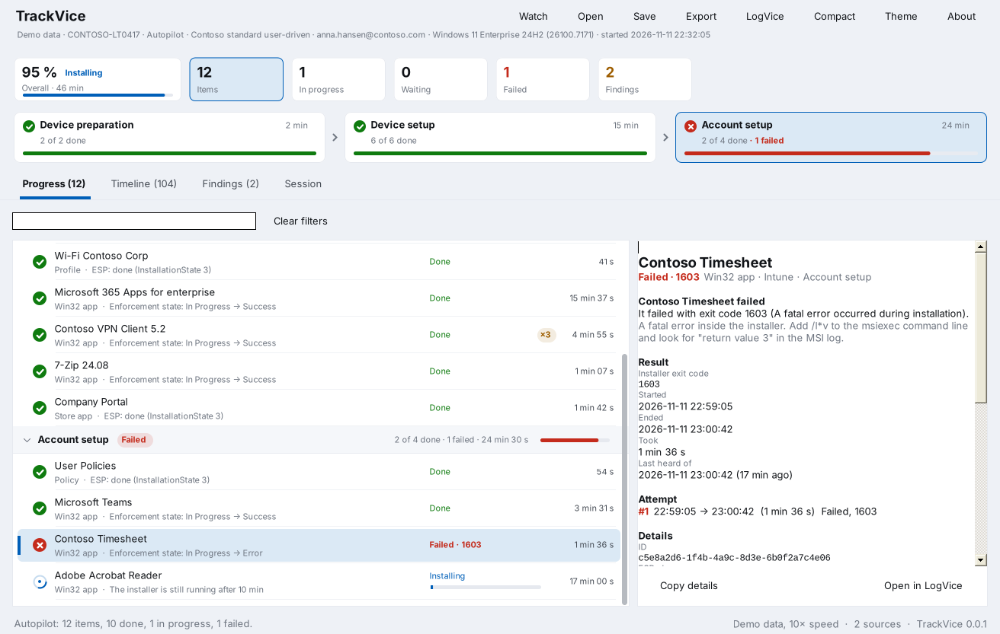
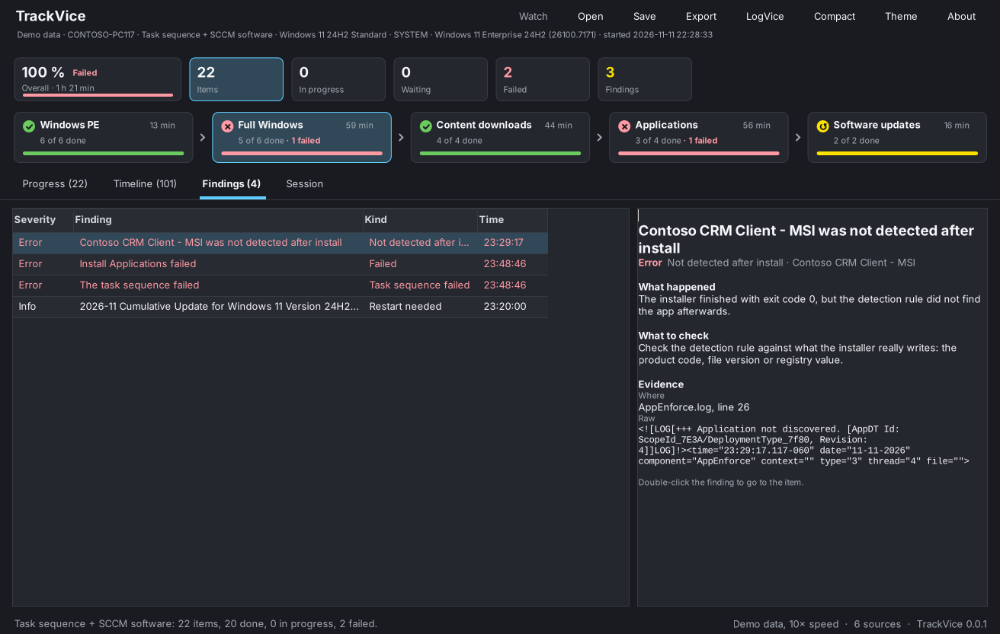
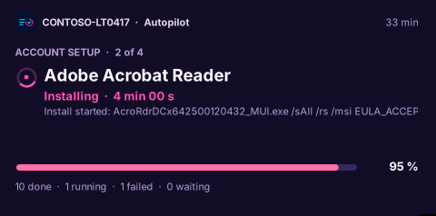
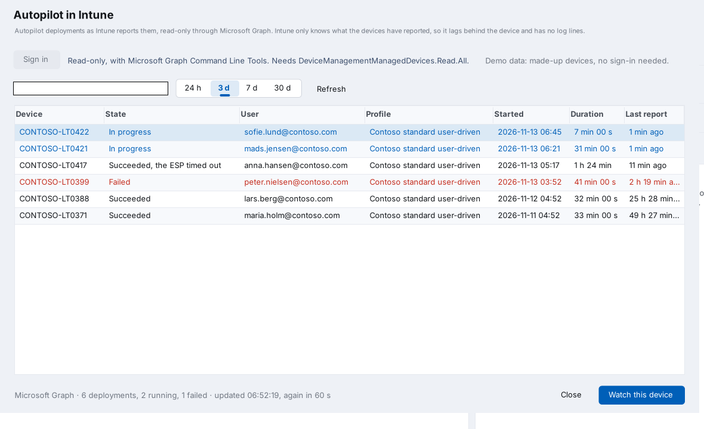
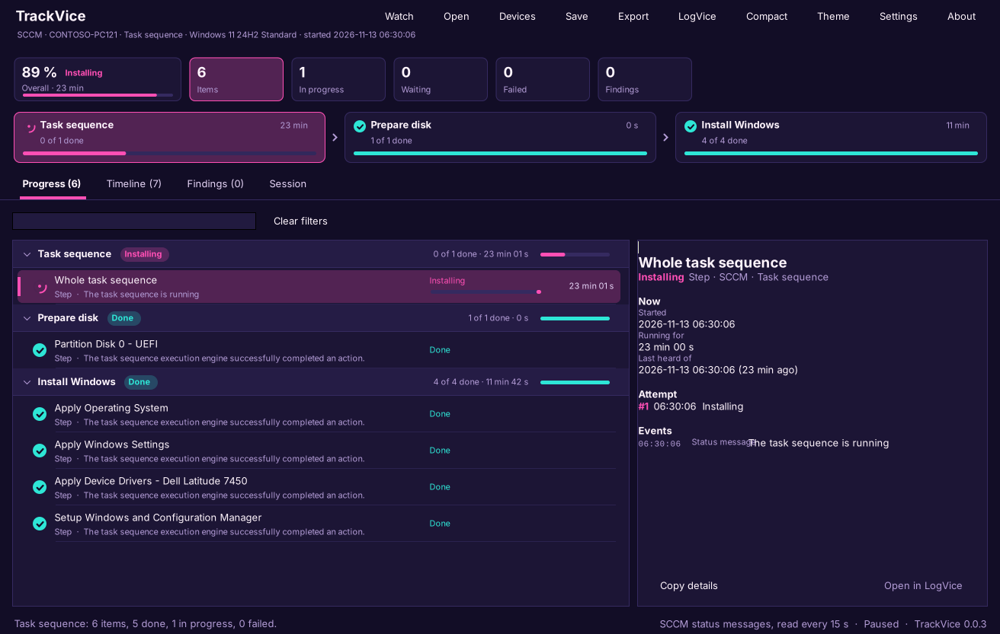
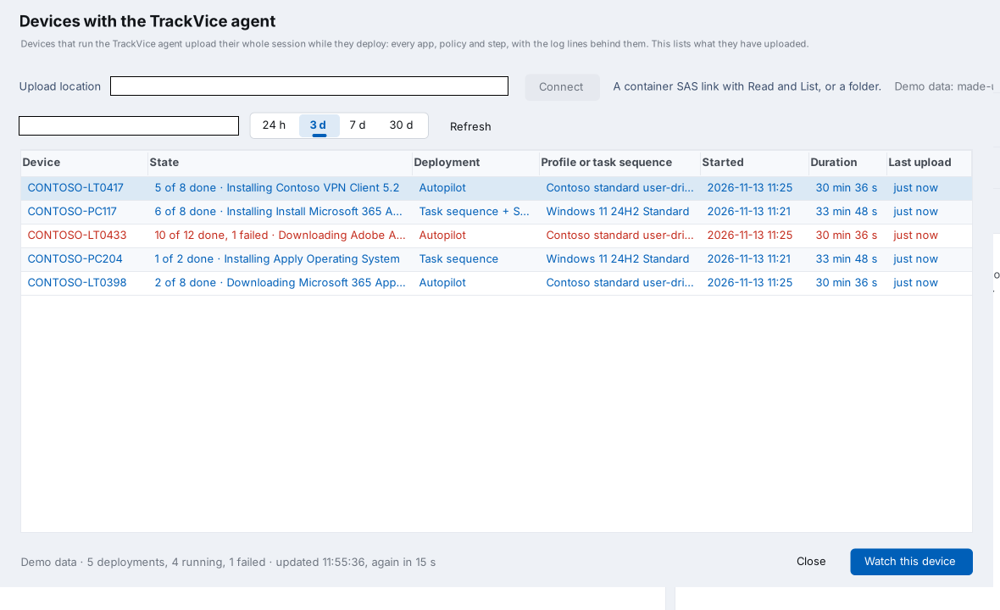
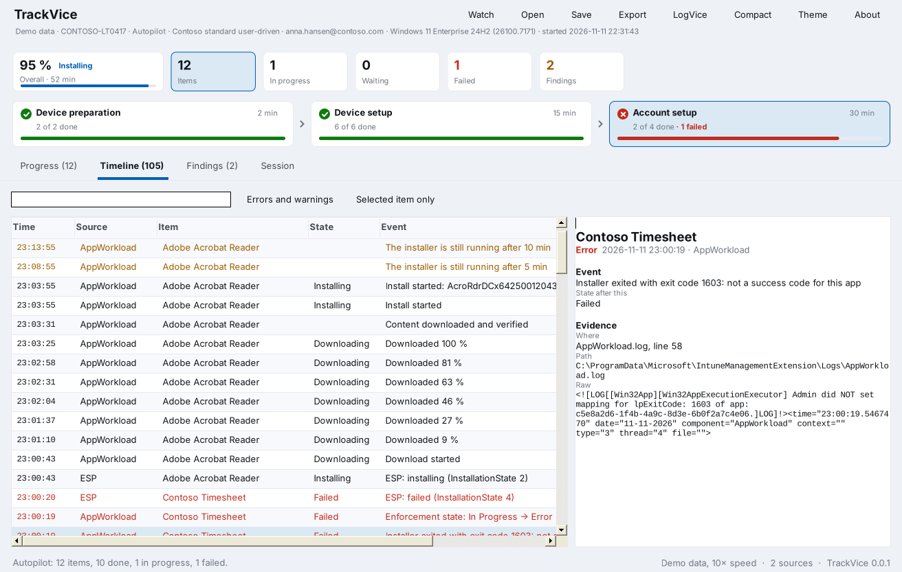
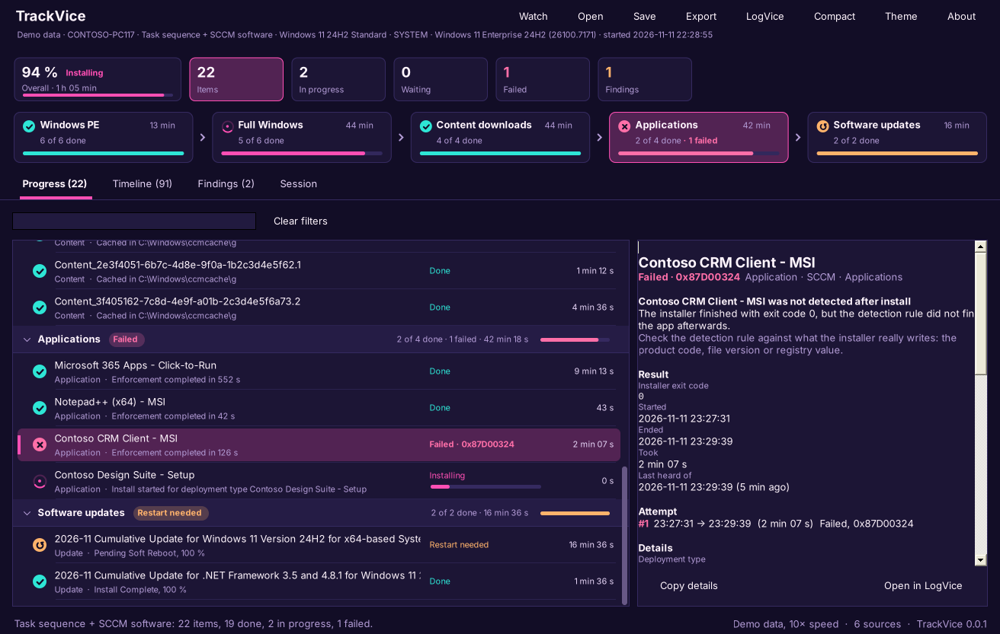

<p align="center"></p>

# TrackVice

TrackVice follows a deployment on one Windows device while it happens: an SCCM task sequence, SCCM applications, packages and updates, Windows Autopilot with the Enrollment Status Page, and Intune Win32 apps. It shows every phase and every step, app, update and policy in it, what each one is doing right now, and the log line behind it.

It can also follow **other devices** from your own PC: Autopilot deployments as Intune reports them, and task sequences from the status messages they send to your SCCM site.

It is a companion to [LogVice](https://github.com/Baldissera88/LogVice) and [PolicyVice](https://github.com/Baldissera88/PolicyVice): one portable exe, no installs, no cloud sign-in, and the log behind any step opens in LogVice with one click.



> **TrackVice is a preview.** Everything below works with the built-in demos and has tests, but it has hardly run on real devices yet, and the views of other devices have not run against a real Intune tenant or SCCM site. The log formats of the Intune Management Extension and the ESP registry layout are not documented by Microsoft, so expect some lines to be missed until it has been tested on real deployments. [docs/TESTING.md](docs/TESTING.md) is the checklist for that.

## What it shows

| Part | Contents |
|---|---|
| Overall | How far the deployment has come, its state and how long it has run |
| Counts | Items, in progress, waiting, failed and findings. Click one to filter the list |
| Phase rail | Each phase as a card with its state, count, time and progress. Click one to jump to it |
| Progress | Every item under its phase, with a live spinner, download progress, tries, duration and its last event |
| Details | For the selected item: findings, the result with the error decoded, every attempt, the command line, IDs, its events and the raw log line |
| Timeline | Every event from every source, newest first, with a filter for errors and warnings or the selected item |
| Findings | What needs attention, with what happened, what to check and the evidence |
| Session | The device, the deployment (task sequence, Autopilot profile, tenant, join type, ESP time limit), and every log and key that was read |

## What it follows

| Deployment | Phases | Read from |
|---|---|---|
| SCCM task sequence | Windows PE, full Windows | `smsts.log` in all its places as it moves: `X:\Windows\Temp\SMSTSLog`, `_SMSTaskSequence\Logs\Smstslog`, `CCM\Logs\SMSTSLog` and `CCM\Logs` |
| SCCM applications | Applications | `AppEnforce.log`, `AppDiscovery.log`, `AppIntentEval.log`, and `CCM_Application` in `root\ccm\ClientSDK` |
| SCCM packages and programs | Packages | `execmgr.log` and `CCM_Program` |
| SCCM content | Content downloads | `CAS.log` |
| SCCM software updates | Software updates | `UpdatesDeployment.log`, `UpdatesHandler.log` and `CCM_SoftwareUpdate` |
| Autopilot and the ESP | Device preparation, device setup, account setup | `HKLM\SOFTWARE\Microsoft\Windows\Autopilot\EnrollmentStatusTracking`, the Autopilot profile, the ESP time limit, and the Autopilot event log |
| Intune Win32 apps | Intune apps, or the ESP phase that waits for them | `IntuneManagementExtension.log`, `AppWorkload.log`, `AgentExecutor.log` and the `Win32Apps` key |
| MDM and Entra | On the timeline | The DeviceManagement Admin, User Device Registration and AAD event logs, errors and warnings only |

Every source is mapped to one set of states: waiting, downloading, installing, detecting, restart needed, done, failed, skipped and not applicable. The original code stays on the event. Win32 app names come from the IME logs, the same way PolicyVice finds them.

## Findings

| Finding | Meaning |
|---|---|
| **Failed** | An item failed. The error is decoded: Windows Installer codes, HRESULTs, and the ConfigMgr codes that come up most, with a hint where one helps |
| **Not detected after install** | The installer finished with a success code, but the detection rule did not find the app afterwards (0x87D00324 in SCCM, 0x87D1041C in Intune) |
| **Retry loop** | An item was tried three times or more and at least two attempts failed |
| **Restart needed** | An item installed and is waiting for a restart (3010, 1641, pending soft or hard reboot) |
| **ESP time limit** | Device setup or account setup has run past the time limit in the ESP profile. Lists what it is still waiting for |
| **No progress** | While watching: an item has been downloading or installing for 15 minutes without any source saying anything about it |
| **Task sequence failed** | The task sequence ended with an error |
| **MDM errors** | The DeviceManagement Admin event log has errors from the deployment |



## Where to run it

| Where | How to start it | What it sees |
|---|---|---|
| Windows, as administrator | Start menu, or the portable exe | Everything |
| Autopilot OOBE and the ESP | Shift+F10, then run `TrackVice.exe` from a USB stick or a share | ESP, Autopilot, IME logs, event logs |
| Task sequence, full Windows part | F8 command prompt (command support must be enabled on the boot image) | smsts.log, and the ConfigMgr logs and WMI once the client is installed |
| Task sequence, Windows PE part | F8 command prompt | smsts.log only, and only if the boot image has the WinPE-NetFx component |

**Compact** opens a small window that stays on top: the phase, what is installing now with its progress, overall progress and the counts. It is made for OOBE screens and for watching over someone's shoulder.

<p align="center"></p>

## Other devices

**Devices** (Ctrl+D) lists deployments on other devices and follows the one you pick, in the same window as a local deployment.



### Autopilot in Intune

TrackVice signs in to Microsoft Graph with a device code, read-only, and reads the Autopilot deployment events that the Intune Autopilot deployments report is built on.

| | |
|---|---|
| Permission | `DeviceManagementManagedDevices.Read.All`, delegated. Your tenant may need an administrator to consent to it |
| App | Microsoft Graph Command Line Tools, or your own app registration set in Settings |
| The list | Device, state, user, profile, when it started, how long it has run and when Intune last heard from it. Refreshed every minute |
| One device | Device setup and account setup with their state and duration, the failure Intune recorded, and every app and policy with its status and error code, split into what the ESP waits for and the rest. Read every minute |
| Sign-in | Kept in memory only, never saved |

Intune only knows what a device has reported, so this view lags behind the device and has no log lines. For every step as it happens, run TrackVice on the device itself.

### Task sequences in SCCM

TrackVice connects to the SMS Provider with your Windows account, the way the console does, and reads the status message each task sequence step sends to the site (`SMS_TaskSequenceExecutionStatus`).

| | |
|---|---|
| Rights | A role that can read task sequence deployment status, for example Read-only Analyst, and remote WMI access to the SMS Provider |
| The list | Device, state with the last step, task sequence, deployment, when it started and the last status. Refreshed every 30 seconds |
| One device | Each step under its task sequence group, with its exit code and the step's output as evidence. Read every 15 seconds |

Status messages arrive a little after each step, and a step only shows once it has reported. A device in Windows PE with no network sends nothing until it can reach the management point.



### Devices with the TrackVice agent

Intune and SCCM only know what a device has reported. With the agent, the device sends everything: TrackVice runs on it without a window while it deploys, and uploads its whole session as it changes to an Azure Storage container or a folder. The list shows every device that has uploaded, and watching one gives the same view as running TrackVice on it, with the log lines behind every event.



| | |
|---|---|
| Install | An Intune platform script (`agent/Install-TrackViceAgent.ps1`) or a Win32 app that runs `TrackVice.exe /agent-install /upload "<location>"` |
| On the device | A startup task that runs as SYSTEM, survives restarts, and removes itself after 48 hours |
| Location | A container SAS link: Create and Write for the devices, Read and List for the viewer. Or a folder |
| The list | Device, progress with the current item, deployment, profile, start, duration and last upload. Refreshed every 15 seconds |
| One device | Everything the device itself shows. Read every 5 seconds |

[docs/AGENT.md](docs/AGENT.md) has the setup step by step.

All three have a demo with made-up devices under **Devices**, so you can see them without signing in.

## Watch, save and share

**Watch** reads the device every 2 seconds: new log lines, ESP tracking changes and new event log records every time, and the Win32 app registry state and ConfigMgr client WMI every third time. It reads logs from the last 24 hours when it starts. On a device that was deployed some time ago, set **History to read** to **Since install**.

ESP and Win32 app states come from the registry, and always carry the time their key was written, so a deployment that finished weeks ago shows when it really happened.

## Settings

**Settings** (Ctrl+,) holds the theme, how far back to read (6 hours to 30 days, or everything since Windows was installed), whether to read ConfigMgr client WMI and the event logs, whether to start watching when TrackVice opens, how often to read while watching, how long to wait before an item gets a **No progress** finding, and where LogVice is. They are kept in `HKCU\Software\TrackVice`.

**Save > Save the session** writes everything as one JSON file that opens on any PC. **Save > Collect the session and its logs in a zip** adds every log file the session has a line from, so a supporter can send the evidence instead of the device. **Open > Open a folder of logs** reads a CCM Logs folder, an IME Logs folder or an unpacked bundle; it reads every log TrackVice knows in it and its subfolders, including rolled-over copies.

**Export** writes an HTML report with the phases, findings and timeline, or every event as CSV.



## Try it without a deployment

`TrackVice.exe --demo` plays an Autopilot deployment: a user-driven Entra join where a VPN client hits error 1618 twice before it installs, an app fails with 1603, and Adobe Acrobat Reader never finishes and runs into the ESP time limit.

`TrackVice.exe --demo osd` plays an SCCM task sequence through Windows PE and full Windows, with content downloads, software updates that need a restart, and an application that installs with exit code 0 but is not detected afterwards, which fails the task sequence.

Both demos are written as real log lines and ESP registry values and read through the same code as a real device, at 10 times the speed. The screenshots in this README come from them.



## Command line

```text
TrackVice.exe                          Watch this device
TrackVice.exe <session.json>           Open a saved session
TrackVice.exe <folder>                 Read a folder of logs
TrackVice.exe /report <file.html>      Save an HTML report of this device and exit
TrackVice.exe /csv <file.csv>          Save every event as CSV and exit
TrackVice.exe /session <file.json>     Save the session as JSON and exit
  /folder <path>                       Read a folder of logs instead of this device
  /hours <n>                           Hours of history to read (default 24, 0 since Windows was installed)
TrackVice.exe /agent-install /upload <location>   Install the agent, see docs/AGENT.md
  /keep <hours>                        How long the agent stays (default 48)
TrackVice.exe /agent-remove            Remove the agent
TrackVice.exe /agent /upload <location> [/once]   Run the agent without installing it
TrackVice.exe --demo [osd]             Play a demo
```

The exit code is 0 when done, 1 on an error and 2 when failed items were found, so it works in a script or an Intune remediation. In PowerShell, use `Start-Process -Wait -PassThru` to get the exit code.

## Keyboard

| Key | Action |
|---|---|
| F5 | Read everything again |
| Ctrl+W | Start or pause watching |
| Ctrl+F | Search items, IDs and command lines |
| Ctrl+O | Open a saved session |
| Ctrl+S | Save the session |
| Ctrl+E | Export an HTML report |
| Ctrl+L | Open the selected item's log in LogVice |
| Ctrl+M | Compact view |
| Ctrl+D | Other devices |
| Arrow keys | Move through the list; Left and Right fold and unfold a phase |
| Ctrl+, | Settings |
| F1 | About and the command line |

## Privacy and safety

TrackVice only reads. It never starts, retries or cancels a deployment, and writes nothing to the device except its own settings in `HKCU\Software\TrackVice` and the files you save. It makes no network connections unless you open **Devices**: then it talks to Microsoft Graph, to the SMS Provider you name, or to the upload location you enter, and nothing else.

The agent is the one exception, and only where you install it: it adds a scheduled task, a folder in Program Files and a registry key, uploads the device's session to the location you gave it, and removes its task and key when its time is up.

## Limitations

- It has not been tested on many real devices yet. See the note at the top.
- The Intune view uses a beta Graph API, which Microsoft can change, and the status message names the SCCM view reads differ a little between ConfigMgr versions.
- The agent has not run on a real device or a real storage account yet, only against the storage emulator and a folder.
- LogVice opens a log file but cannot yet jump to a line, so TrackVice says in the status bar which line to look for.
- The Intune Management Extension log format changes between IME versions. Lines TrackVice does not recognise are left out, and the ESP and Win32Apps registry keys still give the state.
- The Windows PE part of a task sequence needs WinPE-NetFx in the boot image for TrackVice to start there.
- User-targeted SCCM applications are only fully visible from the user's own session.
- The exe and MSI are unsigned. SmartScreen warns on downloaded copies, and AppLocker or WDAC need them signed with your own certificate.

## Build from source

TrackVice is plain C# 5 and Windows Forms on .NET Framework 4.5, with no NuGet packages, like LogVice and PolicyVice.

**On Windows**, with the compiler that ships with .NET Framework:

```powershell
.\build.ps1          # TrackVice.exe
.\build.ps1 -Msi     # also TrackVice.msi, needs WiX Toolset 3
```

**On Linux or macOS**, with Mono and msitools:

```sh
./build.sh           # TrackVice.exe
./package.sh         # TrackVice.exe and TrackVice.msi
./tests/run.sh       # the tests
```

| Path | Contents |
|---|---|
| `src/Model.cs` | Session, phases, items, attempts, events, evidence, findings; JSON save and load |
| `src/Track.cs` | Observations, the tracker that builds the session, findings and error decoding |
| `src/CmLog.cs` | CMTrace and simple ConfigMgr log parsing, and the tailer that follows a growing log |
| `src/Sccm.cs` | smsts.log, AppEnforce, AppDiscovery, AppIntentEval, execmgr, CAS and update logs |
| `src/Intune.cs` | IME logs, ESP tracking, Win32 app state and the Autopilot profile |
| `src/Ime.cs` | The Win32 app registry reader and error codes, shared with PolicyVice |
| `src/Live.cs` | Reads this device: log discovery, registry, ConfigMgr client WMI, event logs; and folders of logs |
| `src/Engine.cs` | Ties a source (device, folder, file, demo) to the session |
| `src/Remote.cs` | Other devices through Intune: Graph sign-in, Autopilot events and policy status |
| `src/RemoteSccm.cs` | Other devices through SCCM: the SMS Provider and task sequence status messages |
| `src/Report.cs` | HTML, CSV and the zip bundle |
| `src/Demo.cs` | The two demos, written as real log lines and registry values |
| `src/Ui.*.cs` | The window, the phase rail, the progress list, the compact view and the themes |
| `tests/` | Log parsing and tailing, every parser, the tracker, findings, save and load, and both demos end to end |
| `art/` | The icon, drawn in the same style as the other Vice icons |

## License

TrackVice is released under the [MIT license](LICENSE).

## Author

Developed by **Daniel L. Baldissera**.
