<p align="center">
  
</p>

<h1 align="center">TrackVice</h1>

<p align="center">
  Follow SCCM task sequences and Intune Autopilot deployments while they happen, on the device or from your own PC.
</p>

<p align="center">
  
  <a href="../../actions/workflows/build.yml"></a>
  
  
  
  <a href="LICENSE"></a>
</p>

TrackVice follows a Windows deployment while it happens: an SCCM task sequence, SCCM applications and updates, Windows Autopilot with the Enrollment Status Page, and Intune Win32 apps. It shows every phase and every step, app, update and policy, what each one is doing now, and the log line behind it.

It can also follow **other devices** from your own PC: Autopilot deployments as Intune reports them, task sequences from your SCCM site, and, with the small [TrackVice agent](docs/AGENT.md) on the devices, everything each device sees while it deploys. It is one portable exe with no install. The log behind any step opens in [LogVice](https://github.com/Baldissera88/LogVice) with one click, and LogVice 2.0 or later opens it at the line, in the same theme.

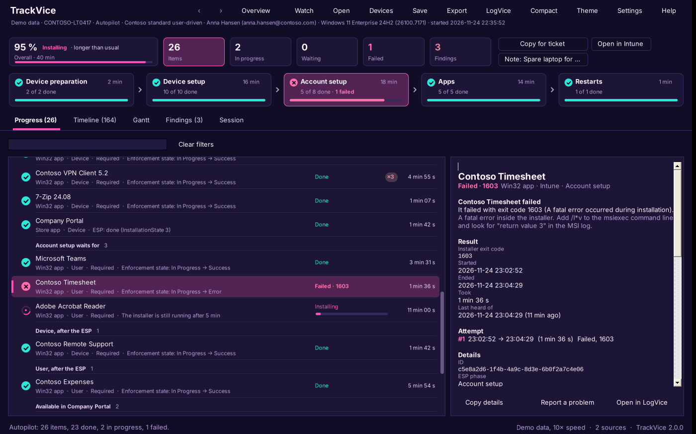

**[Download the latest release](https://github.com/Baldissera88/TrackVice/releases/latest)**: `TrackVice.msi` or the portable `TrackVice.exe`. It needs .NET Framework 4.5 or later, which Windows 10 and 11 have. The files are not code signed, so SmartScreen warns on the first start. Each release has `SHA256SUMS.txt` with the hash of every file. TrackVice updates itself after that, see [Updates](docs/REFERENCE.md#updates).

**On this page:** [What's new in 2.0](#whats-new-in-20) · [Quick start](#quick-start) · [Features](#features) · [Same setup on every PC](#same-setup-on-every-pc) · [Permissions](#permissions) · [Troubleshooting](#troubleshooting) · [Privacy](#privacy-and-data) · [More documentation](#more-documentation) · [Build from source](#build-from-source) · [License](#license)

## What's new in 2.0

TrackVice 2.0.0 brings together everything since 1.10.0. The full list is in [CHANGELOG.md](CHANGELOG.md).

- **Your storage in one step.** Sign in to Azure, pick the subscription, make or choose the storage account and set it up. The subscription box, the ID line and the account list always belong to the same subscription, also in New customer and Add customer.
- **The same setup on every PC.** Customers, Your storage and the update key are saved to your own Key Vault and fetched on another PC after an Entra ID sign-in.
- **Names from Intune** for platform scripts, apps, remediations and configuration profiles.
- **Downloads** of a deployment's scripts and apps, by permission.
- **A narrow overview.** Tiles shrink and wrap instead of disappearing, down to about 700 pixels.
- **Clearer errors.** Errors wrap in the footer, and subscriptions show the start of their ID.

## Quick start

Pick the path that fits. Each one stands on its own.

| I want to | Setup | Go to |
|---|---|---|
| See what deploys on this PC now | None | [A](#a-follow-this-pc-now-no-setup) |
| Follow SCCM task sequences on other devices | Your storage, a customer, a step in the task sequence | [B](#b-follow-sccm-task-sequences) |
| Follow Intune Autopilot devices at customers | Your storage, Add customer, a platform script | [C](#c-follow-intune-autopilot-devices-at-customers) |

### A. Follow this PC now (no setup)

1. Download `TrackVice.exe` and start it **as administrator**. Without that, logs and registry keys that need administrator rights are left out.
2. On the welcome page, choose **Follow this device**. TrackVice reads the PC and keeps watching it.
3. Open the tabs to see what happens: **Progress**, **Timeline**, **Gantt**, **Findings** and **Session**.
4. To watch an Autopilot device in OOBE or the ESP, press Shift+F10 and run `TrackVice.exe` from a USB stick or a share. In a task sequence, press F8 and run it there. On a device that deploys, TrackVice follows it at once and shows no welcome page.
5. Want to look around first? Choose **Look around** on the welcome page. It plays a made-up Autopilot deployment, and `TrackVice.exe --demo osd` plays a task sequence. Nothing on your PC or in Intune is used.

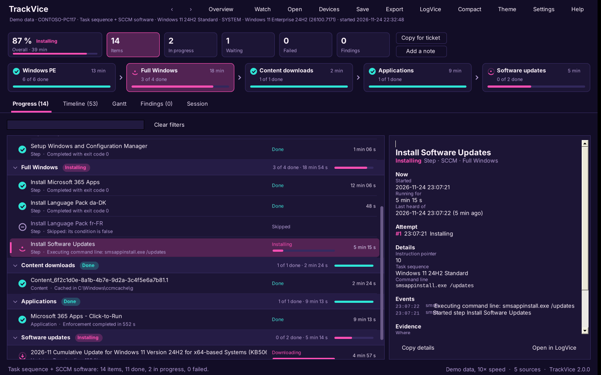

### B. Follow SCCM task sequences

You can follow a task sequence in two ways. Both show up in **Devices > SCCM / on-premises**.

- **Without the agent (read only).** Choose **Devices > SCCM / on-premises > SMS Provider connection** and enter the server, usually the site server. TrackVice connects with your Windows account and reads the status message each step sends to the site. You need a role that can read task sequence deployment status, such as Read-only Analyst. Then open **Task sequences in SCCM**. A step shows only after it has reported.
- **With the agent (every log line, also in Windows PE).** The agent runs in the task sequence and uploads the whole session to your Azure storage. Follow these steps:

1. **Set up Your storage once.** Choose **Settings > Your storage > Set up**, sign in to Azure, pick the subscription and the storage account. The guide says what it makes and asks first.
2. **Add your organization as a customer.** Choose **Devices > Intune / cloud > Add customer**. In step 2 you can choose **Skip**, since SCCM needs no Intune script. Create makes a private container and a customer code.
3. **Connect to the SMS Provider.** Choose **Devices > SCCM / on-premises > SMS Provider connection**.
4. **Add the agent to a task sequence.** Choose **Devices > SCCM / on-premises > Add the agent to a task sequence**. TrackVice makes the package **TrackVice agent**, and adds a step after Partition Disk and one after Setup Windows and ConfigMgr. It shows what it will change, asks first and keeps a copy of the task sequence so that **Undo** works. To do it by hand, use a Run Command Line step with `TrackVice.exe /agent-start /customer "<customer code>"`.
5. **Check the boot image.** The Windows PE part needs the **WinPE-NetFx** component on the boot image.
6. **Run the task sequence on a test device**, and open **Devices > SCCM / on-premises > Devices with the agent in a task sequence**. The device shows up while it runs.

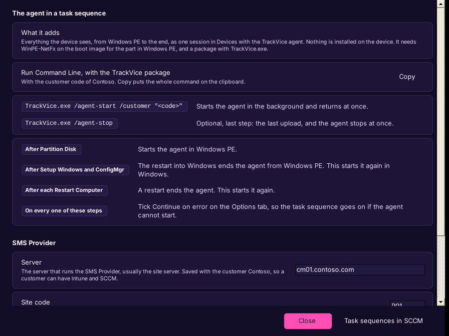

The details are in [docs/AGENT.md, SCCM task sequences](docs/AGENT.md#sccm-task-sequences).

### C. Follow Intune Autopilot devices at customers

This is the full setup. You do it once for Your storage, and then once for each customer.

The **Get started** page (Devices > Get started) walks through the same steps and ticks each one when TrackVice sees it is done.

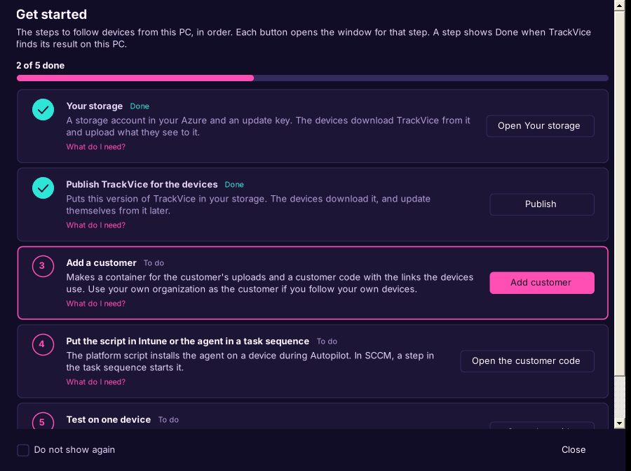

1. **Set up Your storage once.** Choose **Settings > Your storage > Set up**. It makes one storage account in your own Azure for all customers. You need Contributor on the subscription for a new account, or Storage Account Contributor on an existing one. See [Permissions](#permissions).

   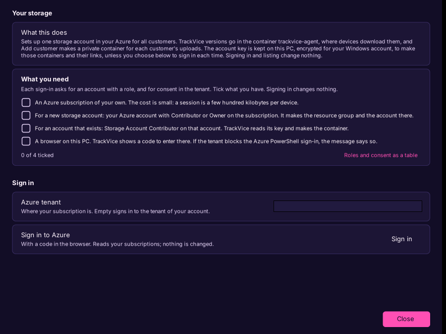

2. **Add the customer.** Choose **Devices > Intune / cloud > Add customer**. Step 1 asks for the customer name. Step 2 signs in to the customer's tenant. Step 3 shows exactly what **Create** will make, and nothing is made before you press it.

   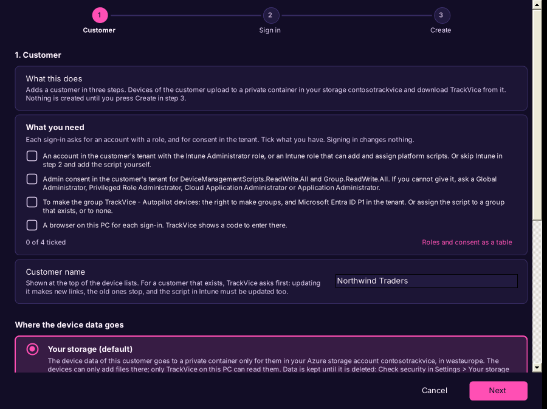

3. **Choose who gets the script (step 3).** The default creates the group **TrackVice - Autopilot devices**, which holds every Autopilot device. In a production tenant, start with **a group I choose** that holds a few test devices, then change the assignment later.

   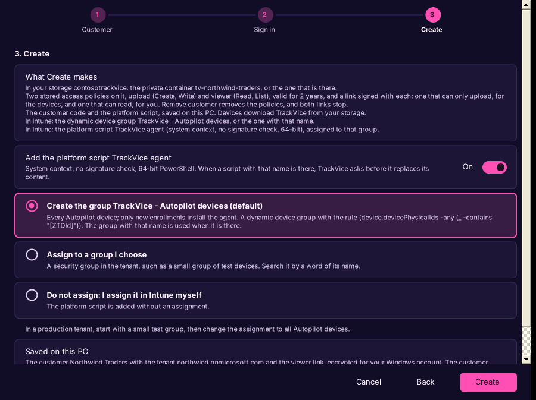

4. **Press Create.** TrackVice makes a private container `tv-<customer>`, two links, the **customer code**, and the script `Install-TrackViceAgent-<customer>.ps1` in `Documents\TrackVice\Scripts`. If you signed in to Intune, it also adds the platform script **TrackVice agent**. If you skipped that, add the saved script to Intune yourself: system context, no signature check, 64-bit PowerShell, assigned to a device group.
5. **Test on one device.** On a test PC, in PowerShell as administrator, run `.\TrackVice.exe /agent-install /customer "<customer code>"`. Check that it appears in the list (next step), then run `TrackVice.exe /agent-remove` to take it off again.
6. **Follow the devices.** Choose **Devices > Intune / cloud > Devices with the TrackVice agent**, with the customer chosen at the top. A device shows up during device setup. Select it and choose **Watch this device** to see it as if you sat at it.

**A share instead of Azure storage.** For domain-joined devices on the company network (SCCM task sequences and Hybrid Autopilot), **Devices > Intune / cloud > New customer with links** also offers **Share (UNC)** in step 2, such as `\\server\TrackVice\Contoso`. TrackVice checks the share from your PC, shows the permissions the devices need and copies the icacls commands. The Links step is skipped, TrackVice.exe and the signed agent update are put in an `agent` folder on the share, and the script and the task sequence command use the share. It does not fit cloud-only Autopilot devices on the internet. See [docs/AGENT.md](docs/AGENT.md#alternative-a-folder-instead-of-a-storage-account).

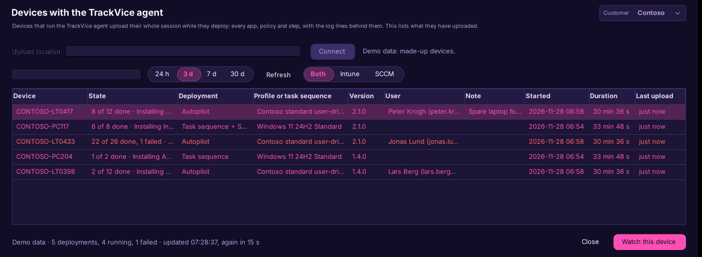

The guide has every step, the customer code, the storage layout and what to do when something fails: [docs/AGENT.md](docs/AGENT.md).

## Features

### Overview and progress

**Overview** (Alt+Home) is the home page on a PC that is not deploying. It shows the devices deploying now, today and the last 7 days, what needs attention (failed devices, agents that stopped sending, findings, a newer version to publish), and which version each customer's agents run and what the place they update from has, recent and pinned devices, and setup. Choose all customers or one, and Intune, SCCM or both. It fits a narrow window.

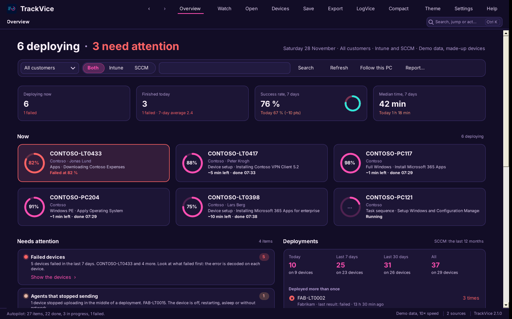

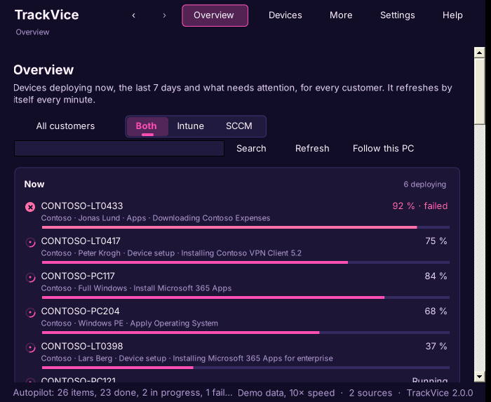

When you follow a deployment, the header shows how far it has come, its state and how long it has run. The tiles count items, in progress, waiting, failed and findings, and click to filter. Each phase is a card with its state and progress. **Progress** lists every item under its phase, with a live spinner, tries, duration and its last event. The details pane shows the result with the error decoded, every attempt, the command line, IDs and the raw log line.

### Timeline, Gantt and Findings

- **Timeline** lists every event from every source, newest first. Select one to see the raw log line behind it.
- **Gantt** shows one bar per item across time, grouped by phase, with a line for each restart.
- **Findings** says what needs attention: what happened, what it means and what to do next, with the evidence.

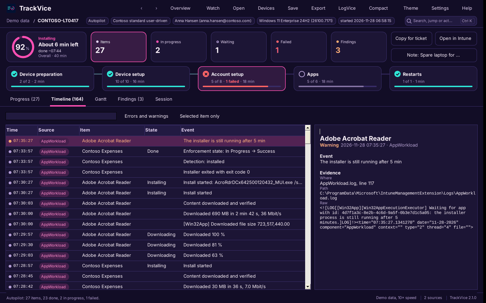

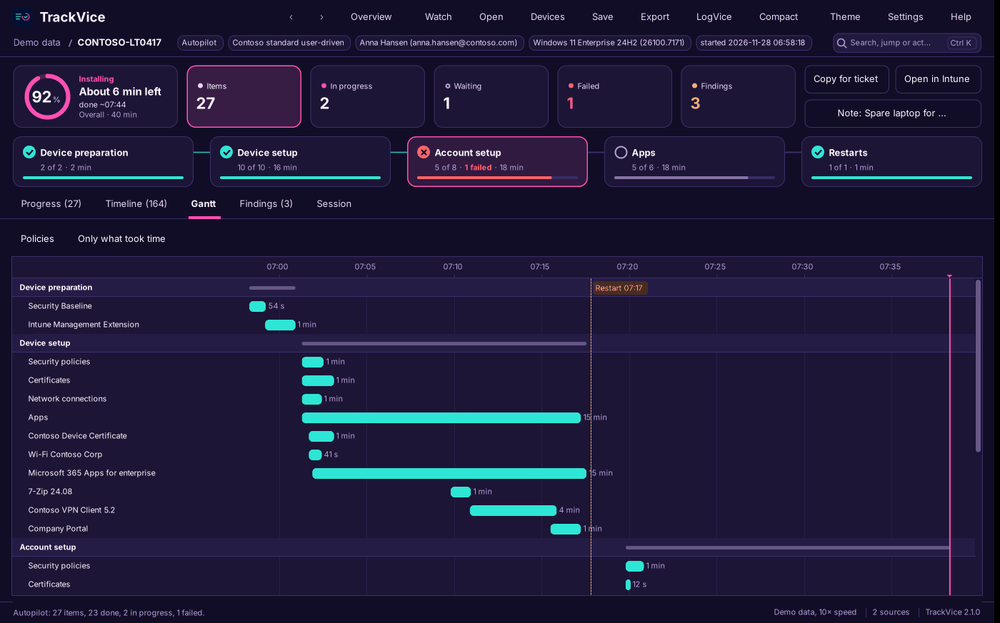

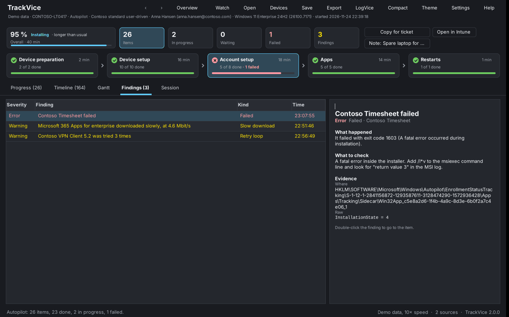

The finding types, and what each deployment type reads from, are in [docs/REFERENCE.md](docs/REFERENCE.md#findings).

### Other devices

**Devices** (Ctrl+D) lists deployments on other devices and follows the one you pick, in the same window. A switch at the top chooses **Intune / cloud** or **SCCM / on-premises**.

- **Autopilot in Intune** reads the deployment events through Microsoft Graph, read only. It lags behind the device and has no log lines.
- **Task sequences in SCCM** reads the status messages from your site.
- **Devices with the TrackVice agent** shows everything the device itself sees, with the log lines.
- **Wall view** shows every device with the agent on one screen, for the room where devices are set up.

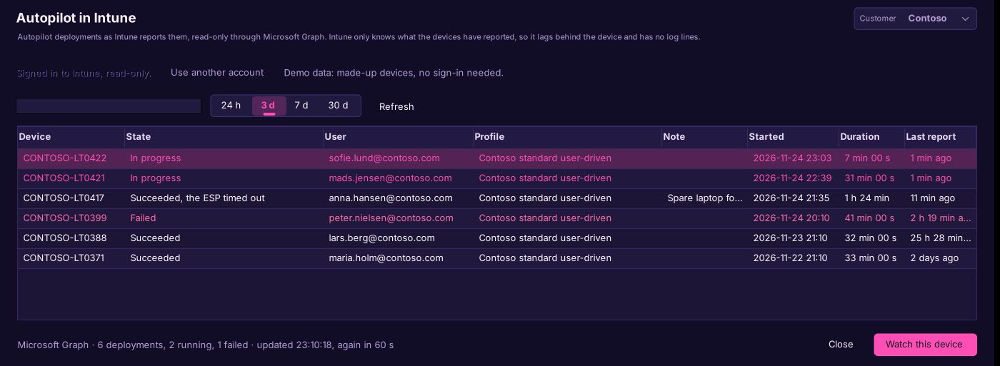

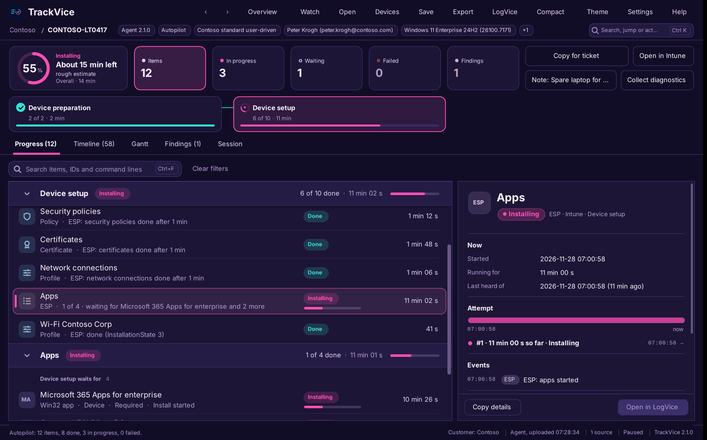

### Compare, Statistics and Reference

- **Compare** puts two enrollments side by side and shows what differs.
- **Statistics** goes over every session the agents uploaded in the last 24 hours, 7, 30 or 90 days, and exports to CSV and Power BI.
- **Reference** keeps one good enrollment, compares every other one with it and writes a ready to ship report.

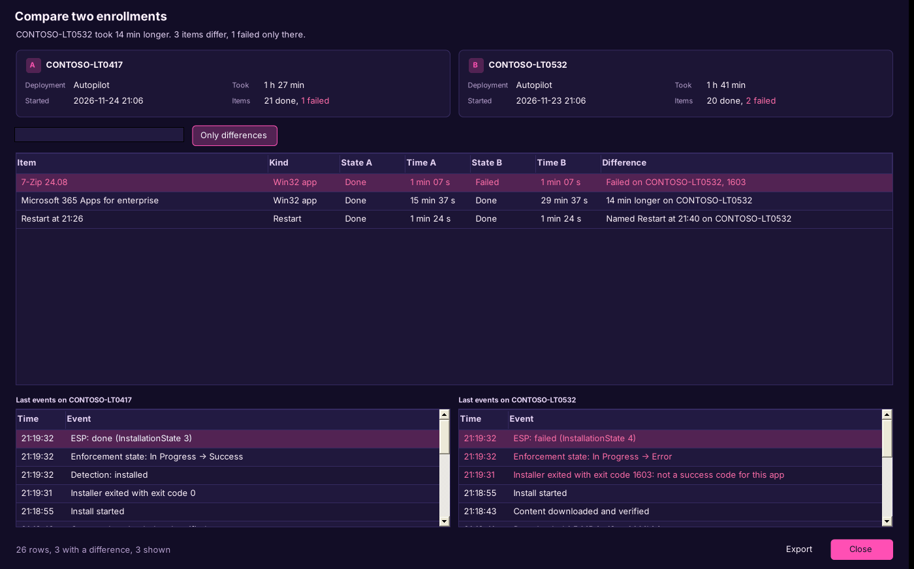

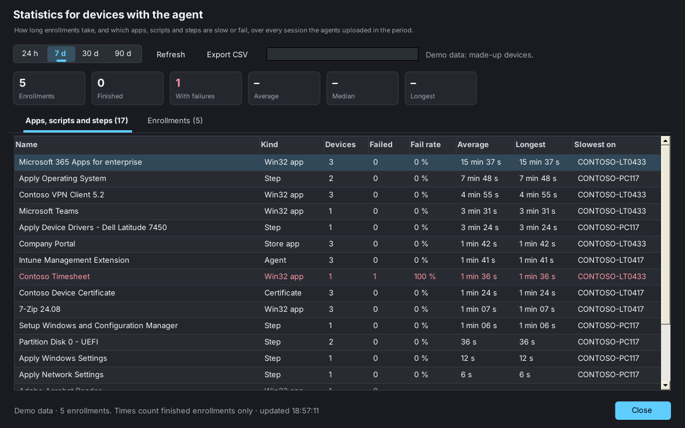

### Names from Intune

A device knows platform scripts, remediations and some apps by ID only. **Devices > Names from Intune** reads the names from Intune, so a script that shows as "Platform script" with the start of its ID gets its real name. Each lookup is its own switch, with its own read permission, and the sign-in asks only for the ones you tick. The names are kept for each customer, and read again once a day.

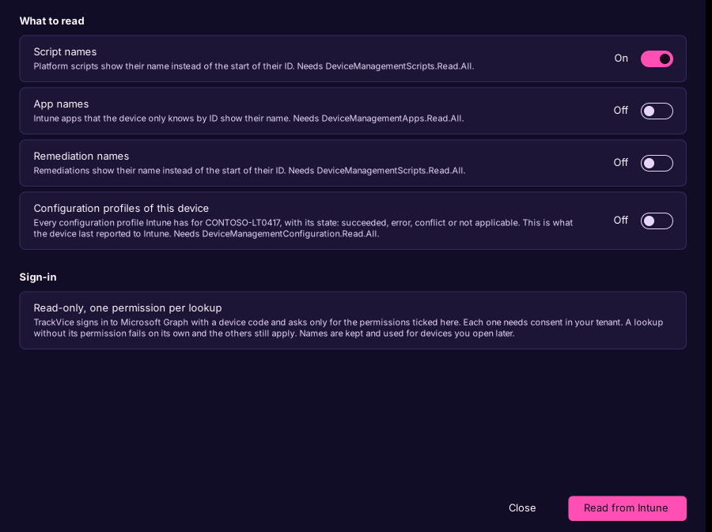

### Downloads of scripts and app details

In a deployment you follow for a customer, right-click an Intune script or remediation, an app, an SCCM task sequence step or an SCCM application and choose **Download…**. You get the script text, command lines or, for an app, its install and uninstall command, detection rule, requirements, return codes and assignments. Installer files are not downloaded.

It is off until you turn on **Allow downloading scripts and app details** for the customer in Settings > Customers. **Ask before each download** and **Hide secrets in downloads** are on at first, and every download is written to `downloads.log` (time, Windows user, customer, item and file name, never the content).

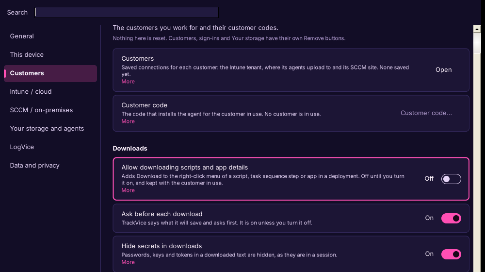

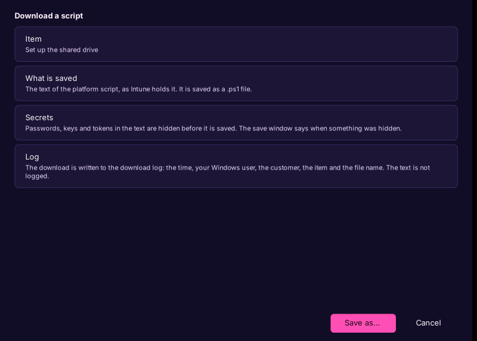

### Compact view and themes

**Compact** (Ctrl+M) opens a small window that stays on top: the phase, what is installing now, overall progress and the counts. It is made for OOBE screens and for watching over someone's shoulder.

<p align="center">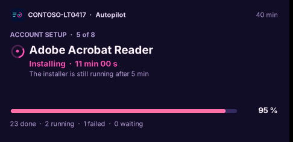</p>

Pick a theme in Settings, with the Theme button, or with `--theme <name>`: **Vice** (the default), **Dark**, **Light**, **Terminal**, **Amber** or **Synthwave**.

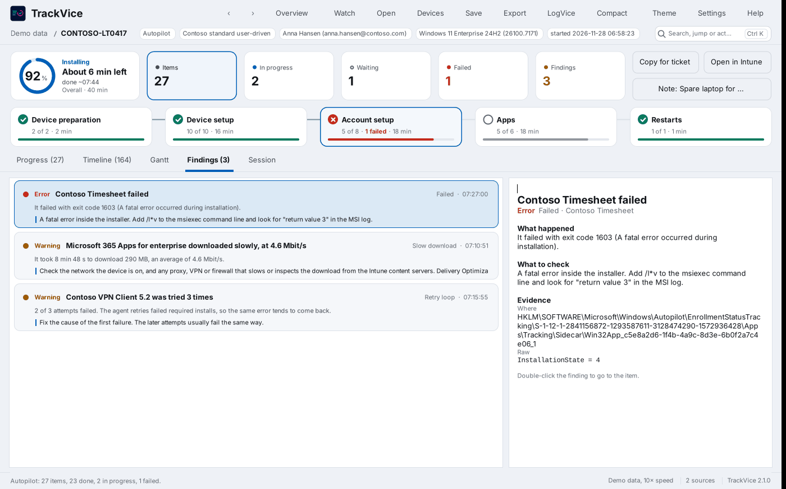

### LogVice

Every item and event has **Open in LogVice**, which opens the log behind it (Ctrl+L). When you watch a device with the agent, **LogVice > Logs from the device** downloads the zip of logs the device uploaded and opens it. If LogVice is not on the PC, its button asks first, then downloads it from GitHub and checks it against the release's `SHA256SUMS.txt`.

### More

Save and share the session, export an HTML report or CSV, run reports from the command line, and use the keyboard shortcuts. The whole list is in [docs/REFERENCE.md](docs/REFERENCE.md#command-line).

## Same setup on every PC

Your customers, Your storage and the update key live on one PC and one Windows user. With an **Azure Key Vault** in your own subscription, a second PC gets the same setup after one Entra ID sign-in.

1. **Make the vault.** It must use **Azure RBAC** as its permission model. Give people the role **Key Vault Secrets User** to read, and **Key Vault Secrets Officer** to add and change.
2. **On the first PC,** choose **Settings > Customers > Key Vault**, enter the vault name or its address, and press **Sign in**. Then press **Save customers to the vault** and pick the customers. Press **Save my setup to the vault** to save Your storage and the update key too.
3. **On another PC,** enter the vault, press **Sign in**, then **Get customers from the vault** and **Get my setup from the vault**. That PC can now publish and add customers like the first one.

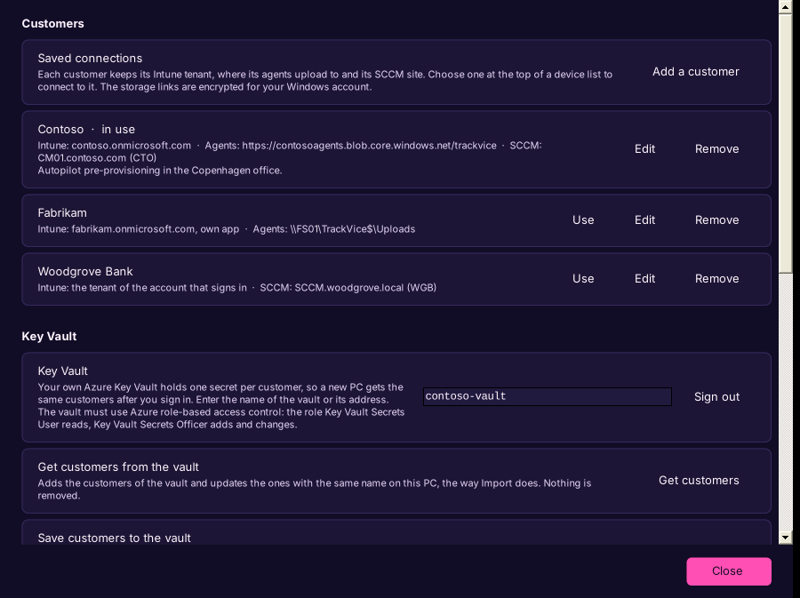

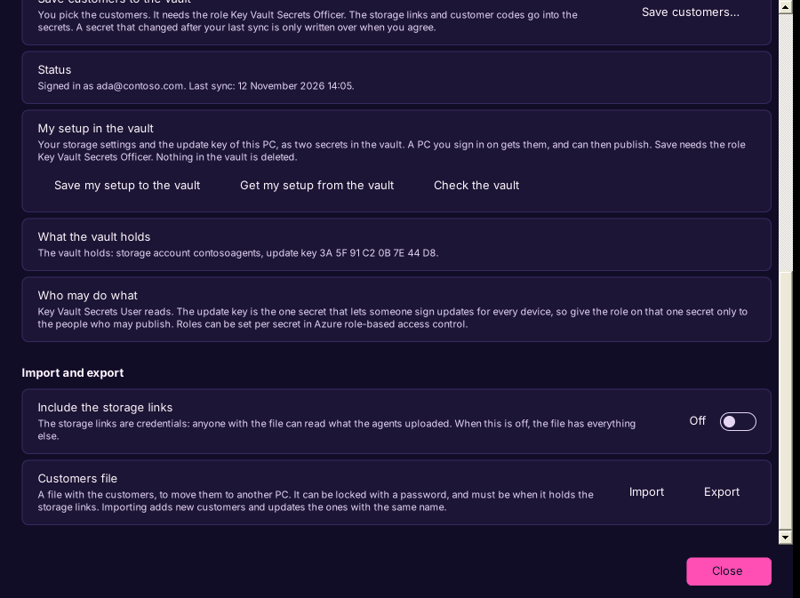

What to know:

- Customers are one secret each. **My setup** is two secrets whose names start with `trackvice-`: one for Your storage (the account, the links and the account key) and one for the update key.
- **Save** only adds and updates. TrackVice never deletes anything in the vault, asks before it overwrites a secret that changed after your last sync, and never replaces a key on the PC without asking.
- The update key is the one secret that lets someone sign updates for every device. Give the role on that one secret only to the people who may publish. Azure RBAC can be set per secret. An account that can read the customers but not the update key gets the rest, and TrackVice says so.
- Key Vault encrypts the secrets and logs who read them. Conditional Access and MFA apply to the sign-in. Each PC keeps its own copy, so it works offline.
- **Get my setup from the vault** is also in **Publish** (when it finds another update key) and on **Get started**.

## Permissions

TrackVice only reads, except where you press a button that creates something. This table says what each feature needs. Graph permissions are **delegated** (they work as the signed-in account) and need consent in the tenant. [Who gives consent, and how](docs/AGENT.md#what-you-need).

| Feature | Azure role | Microsoft Graph permission | Other |
|---|---|---|---|
| Follow this PC | None | None | Run as administrator to see everything |
| Autopilot in Intune (the list) | None | `DeviceManagementManagedDevices.Read.All` | An Intune role that can read devices |
| Names from Intune: scripts and remediations | None | `DeviceManagementScripts.Read.All` | Each lookup is its own switch |
| Names from Intune: apps | None | `DeviceManagementApps.Read.All` | |
| Names from Intune: configuration profiles | None | `DeviceManagementConfiguration.Read.All` | |
| Download scripts, remediations | None | `DeviceManagementScripts.Read.All` | Turn on **Allow downloading** for the customer |
| Download app details | None | `DeviceManagementApps.Read.All` | The same switch |
| Download SCCM steps and applications | None | None | The SMS Provider connection |
| Check devices before enrollment | None | `DeviceManagementServiceConfig.Read.All`; optional `DeviceManagementApps.Read.All` (names of blocking apps) and `Device.Read.All` (groups of a device) | |
| Task sequences in SCCM | None | None | Remote WMI to the SMS Provider, and a role that reads deployment status, such as Read-only Analyst |
| Add the agent to a task sequence | None | None | A security role in the console that can modify packages and task sequences |
| Your storage, list subscriptions and accounts | **Reader** (or Contributor or Owner) on the subscription | None | See [Troubleshooting](#troubleshooting) |
| Your storage, a new account | **Contributor** or **Owner** on the subscription | None | Makes the resource group and the account |
| Your storage, an existing account | **Storage Account Contributor** on the account | None | TrackVice reads its key and makes the container |
| Add customer, in your storage | **Storage Account Contributor** on Your storage account, only when the key is not kept on this PC | None | |
| Add customer, in the customer's own Azure | **Contributor** on a subscription or resource group for a new account, or **Storage Account Contributor** on an existing one | None | Sign in with an account of the customer's tenant |
| Add customer, the Intune part | None | `DeviceManagementScripts.ReadWrite.All` and `Group.ReadWrite.All` | Intune Administrator role, or an Intune role that can add and assign platform scripts. A dynamic group needs Entra ID P1 |
| Customer code…, Update the script in Intune | None | `DeviceManagementScripts.ReadWrite.All` | The same Intune role |
| New customer with links, the Intune part | As Your storage | `DeviceManagementScripts.ReadWrite.All` and `GroupMember.Read.All` | The same Intune role |
| Make the app registration | None | `Application.ReadWrite.All` | Application Developer, Application Administrator or Cloud Application Administrator |
| Key Vault: read customers and setup | None (Azure RBAC on the vault) | None | **Key Vault Secrets User** on the vault. Sign-in is Entra ID, with Azure Key Vault `user_impersonation` |
| Key Vault: save customers and setup | None (Azure RBAC on the vault) | None | **Key Vault Secrets Officer** on the vault |

Notes:

- **Azure roles.** Contributor cannot give roles to others, so an Owner of the subscription gives them: in the Azure portal, open the subscription, then **Access control (IAM)** and **Add role assignment**. A role given a minute ago can take a few minutes to work.
- **Consent.** A Global Administrator, Privileged Role Administrator, Cloud Application Administrator or Application Administrator can give it. In the Microsoft Entra admin center, open **Enterprise apps**, the app, **Permissions** and **Grant admin consent**.
- **The app.** TrackVice signs in as Microsoft Graph Command Line Tools, or as your own app registration set in Settings. See [App registration](docs/AGENT.md#app-registration), which lists each permission and its ID.
- **The Reader row.** Listing subscriptions, resource groups and storage accounts is a read on the subscription. The code does not name the role; Reader, Contributor and Owner all allow it.

## Troubleshooting

**The Existing account list in Your storage is empty.**
It says "This subscription has no storage accounts" and, under it, what Azure answered: the subscription, how many resource groups and storage accounts it found, and the account you are signed in as. Check two things. First, the subscription in the **Subscription** box and the **ID** line under it: it must be the one that holds the account. Pick another subscription if not. Second, your account needs **Reader** (or more) on that subscription, or Azure returns an empty list. If the subscription is in another tenant, enter that tenant in **Azure tenant** and sign in again.

**"Your account may not create the resource group …" or "not authorized … resourcegroups/write".**
You chose **New account**, and your account cannot make the resource group. Either the box shows the wrong subscription (check the ID line), or you lack **Contributor** or **Owner** on it. Ask an Owner of the subscription to give the role, or choose **Existing account** instead: that makes no resource group, and needs only **Storage Account Contributor** on the account.

**Publish says "Not published: latest.json … is signed with another update key than the one on this PC".**
The version in your storage was signed with a different update key, often from the first PC, so devices would refuse what this PC makes. Do not make a new key: that would break every customer code. Press **Get my setup from the vault** in Publish (see [Same setup on every PC](#same-setup-on-every-pc)), or publish from the first PC.

**Agents never update, and Overview says "publish here".**
A customer made with its own storage account or a share checks that place for updates, not Your storage. Open **Settings > Agent updates > Publish agent update**: it lists every place the agents check, what is published there and whether this PC can write there. For a place without write access, press **Add a link** and paste a link with Read, Create and Write for that container, then press **Publish**. See [Update locations](docs/AGENT.md#update-locations).

**No names from Intune.**
Names come from the customer in use, so choose that customer and run **Devices > Names from Intune** for its tenant. Sign in with an account of that tenant and give consent when it asks. Each switch needs its own permission, and a lookup without it fails alone while the others still work. If the sign-in is stale, use **Settings > Intune sign-in > Sign out** and try again.

**The update is refused while you follow a deployment.**
TrackVice says "It is not installed while TrackVice follows a deployment on this device, because the update restarts TrackVice." Update when the deployment is done, or download it and install it on another PC.

**Something else.** Look in [docs/AGENT.md, Troubleshooting](docs/AGENT.md#troubleshooting). It lists the messages of the platform script, the agent and Add customer, and what each one means.

## Privacy and data

TrackVice only reads. It never starts, retries or cancels a deployment, and writes nothing to the device except its own settings in `HKCU\Software\TrackVice` and the files you save.

- **Network.** At every start and every 6 hours while it is open, it asks `api.github.com` for the latest release, unless you turn that off in Settings > Updates (or the policy value `DisableUpdateCheck`). It sends nothing about you or your devices. Otherwise it connects only when you open something under **Devices**, **Your storage** or **Publish agent update**: then it talks to Microsoft Graph, the SMS Provider you name, the upload location you enter, Azure, and your Key Vault.
- **What is kept, and how.** Upload links, the Intune sign-in, the account key of Your storage and customer codes are encrypted for your Windows account. The update key is in `%LOCALAPPDATA%\TrackVice\agent-update-key.bin`, encrypted the same way.
- **The agent** is the one exception, and only where you install it: it adds a scheduled task, a folder in Program Files and a registry key, uploads the device's session to the location you gave it, and removes itself when its time is up. Passwords, keys and tokens are masked before anything leaves the device.
- **Nothing is sent by TrackVice itself.** The Help menu can open a pre-filled GitHub issue or e-mail, and you send it.

The full list of what changes where, and what the agent sends, is in [docs/REFERENCE.md](docs/REFERENCE.md#privacy-and-safety) and [docs/AGENT.md](docs/AGENT.md#what-is-uploaded-and-security).

## More documentation

| Guide | Contents |
|---|---|
| [docs/AGENT.md](docs/AGENT.md) | The agent: Your storage, Add customer, the customer code, task sequences, updates, Key Vault, troubleshooting |
| [docs/REFERENCE.md](docs/REFERENCE.md) | What TrackVice shows and follows, every finding, settings, the command line, keys, privacy and limits |
| [docs/TESTING.md](docs/TESTING.md) | The checklist for checking TrackVice against the logs during real deployments |
| [docs/RELEASE.md](docs/RELEASE.md) | How a release is made |
| [CHANGELOG.md](CHANGELOG.md) | Every change, version by version |
| [ROADMAP.md](ROADMAP.md) | What is planned |

## Build from source

TrackVice is plain C# 5 and Windows Forms on .NET Framework 4.5, with no NuGet packages, like LogVice and PolicyVice.

**On Windows**, with the compiler that ships with .NET Framework:

```powershell
.\build.ps1          # TrackVice.exe
.\build.ps1 -Msi     # also TrackVice.msi, needs WiX Toolset 3
```

**On Linux or macOS**, with Mono and msitools:

```sh
./build.sh           # TrackVice.exe
./package.sh         # TrackVice.exe and TrackVice.msi
./tests/run.sh       # the tests
```

The source layout is in [docs/REFERENCE.md](docs/REFERENCE.md#build-from-source). Releases are described in [docs/RELEASE.md](docs/RELEASE.md).

## Using TrackVice? Tell me

TrackVice collects nothing and sends nothing by itself, so the author only knows you use it when you say so.

- **Help > Tell the author you use TrackVice**: name, company, e-mail and what you use it for, all optional. It opens an e-mail to [dbal.itx@gmail.com](mailto:dbal.itx@gmail.com) or a [GitHub discussion](https://github.com/Baldissera88/TrackVice/discussions) with the text, and you send it.
- **Help > Report a problem**: what happened, what you expected and the steps to repeat it. TrackVice fills in its version, the Windows version, what was open and the last errors it showed, and lists them on the page before anything leaves. Customer names, tenants, device names and links in those errors are replaced. It opens a [bug report](https://github.com/Baldissera88/TrackVice/issues/new?template=bug_report.yml) or an e-mail. A log bundle, with secrets masked, is saved for you to look through and attach yourself.
- **Help > Suggest a feature**: what you would like, why, and how you would use it, as a [feature request](https://github.com/Baldissera88/TrackVice/issues/new?template=feature_request.yml), a discussion or an e-mail.
- **Help > Downloads** shows how often each release was downloaded from GitHub.

None of these is offered on the command line, as the agent, in Windows PE, during Windows setup or the ESP, while a task sequence runs or TrackVice follows a deployment on the device, or as SYSTEM.

## License

TrackVice is released under the [MIT license](LICENSE).

## Credits

Developed by **Daniel L. Baldissera**.
