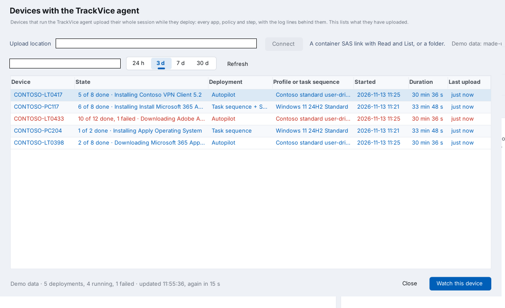

# The TrackVice agent

Intune and SCCM only know what a device has reported. The agent is TrackVice itself, running on the device without a window while it deploys. It reads the device the way the window does and uploads the whole session as it changes: every app, policy and task sequence step, with the log lines, registry values and events behind them.

On your own PC, **Devices > Devices with the TrackVice agent** lists every device that has uploaded and follows one live.



> **Preview.** The upload to a real Azure storage account, the install as a scheduled task on Windows 11 and the list have been tested. A full Autopilot enrollment with the platform script has not been tested yet.

## Contents

- [How it works](#how-it-works)
- [What you need](#what-you-need)
- [Step 1: the storage container](#step-1-the-storage-container)
- [Step 2: upload TrackVice.exe](#step-2-upload-trackviceexe)
- [Step 3: the three links](#step-3-the-three-links)
- [Step 4: test from your own PC](#step-4-test-from-your-own-pc)
- [Step 5: fill in and test the script](#step-5-fill-in-and-test-the-script)
- [Step 6: the platform script in Intune](#step-6-the-platform-script-in-intune)
- [Step 7: follow the devices](#step-7-follow-the-devices)
- [Alternative: a Win32 app](#alternative-a-win32-app)
- [Alternative: a folder instead of a storage account](#alternative-a-folder-instead-of-a-storage-account)
- [Maintenance](#maintenance)
- [Troubleshooting](#troubleshooting)
- [What is uploaded, and security](#what-is-uploaded-and-security)

## How it works

```text
Intune platform script            Device                               Your PC
----------------------            ------                               -------
Install-TrackViceAgent.ps1  --->  downloads TrackVice.exe, checks hash
                                  TrackVice.exe /agent-install
                                  scheduled task "TrackVice Agent"
                                  reads logs, ESP keys, events
                                  uploads sessions/<id>.json.gz  --->  storage container
                                                                       TrackVice lists and follows it
```

| | |
|---|---|
| Install | `TrackVice.exe /agent-install /upload "<upload link>"` copies TrackVice to `C:\Program Files\TrackVice Agent`, saves the link, registers the scheduled task **TrackVice Agent** (SYSTEM, at startup), starts it and returns within seconds, so it does not hold up the Enrollment Status Page |
| While it runs | Reads the device every 2 seconds. Uploads when something changed, at most every 10 seconds, and every 30 seconds otherwise so the list shows it is alive |
| Restarts | The task starts the agent again. It reads everything since Windows was installed and continues as the same row in the list |
| Idle | With nothing running and nothing new for 30 minutes it reads every 15 seconds and uploads every 5 minutes. It wakes up when something starts, such as account setup after pre-provisioning |
| End | After 48 hours (`/keep <hours>`) it uploads one last time and removes its task and the saved link |

The first minutes of a deployment happen before Intune can run anything on the device. They are still in the session, because the agent reads the logs and the ESP registry keys back to the Windows install.

The Intune Management Extension runs platform scripts before it installs Win32 apps, which is why a platform script is the recommended way to install the agent.

## What you need

- An Azure subscription where you can create a storage account, or an existing storage account. The cost is negligible: a session is a few hundred kilobytes per device.
- Intune, with the right to add a platform script.
- `TrackVice.exe` and `agent/Install-TrackViceAgent.ps1` from this repository.

The storage account does not have to be in the same tenant as the devices. The devices only use the upload link.

## Step 1: the storage container

Use an existing storage account, or create one: Azure portal > Storage accounts > Create.

| Setting | Value |
|---|---|
| Performance | Standard |
| Redundancy | Locally-redundant storage (LRS) |
| Advanced > Allow storage account key access | Enabled (the default) |
| Networking > Public network access | Enabled from all networks |

Devices upload from wherever they enroll, so the account has to be reachable from the internet. That setting only decides who can reach the account. The container stays private, and nothing in it can be read or written without a link.

Then create the container:

1. Open the storage account > Data storage > Containers > **+ Container**.
2. Name it `trackvice`. Keep the access level private.

Give TrackVice its own container. A link gives access to the whole container it was made for, so do not reuse a container that holds other files.

## Step 2: upload TrackVice.exe

1. Open the `trackvice` container and choose **Upload**. Upload `TrackVice.exe`.
2. Note the hash of that file. The script checks it before running the exe:

```powershell
(Get-FileHash .\TrackVice.exe -Algorithm SHA256).Hash
```

## Step 3: the three links

A link is a shared access signature (SAS): a URL with a token that allows only what you tick. You need three.

| Link | Made on | Permissions | Goes into |
|---|---|---|---|
| Download | The blob `TrackVice.exe` | Read | `$Download` in the script |
| Upload | The container `trackvice` | Create, Write | `$Upload` in the script |
| Viewer | The container `trackvice` | Read, List | TrackVice on your PC |

For all three: signing method **Account key**, allowed protocols **HTTPS only**, and an expiry you will remember to renew, such as one year. Copy the **Blob SAS URL**, not only the token. The portal shows it once, so save each link as you make it.

**Download link**

1. Open the `trackvice` container and click `TrackVice.exe`.
2. Open the **Generate SAS** tab.
3. Permissions: **Read** only. Set the expiry. Press **Generate SAS token and URL**.

**Upload link**

1. Data storage > Containers. On the `trackvice` row, click `…` > **Generate SAS**.
2. Permissions: **Create** and **Write** only. Set the expiry. Generate.

**Viewer link**

1. On the same screen, change the permissions to **Read** and **List** only.
2. Generate again and copy the new URL.

The links look like this:

```text
Download  https://<account>.blob.core.windows.net/trackvice/TrackVice.exe?sp=r&...&sig=...
Upload    https://<account>.blob.core.windows.net/trackvice?sp=cw&...&sig=...
Viewer    https://<account>.blob.core.windows.net/trackvice?sp=rl&...&sig=...
```

## Step 4: test from your own PC

Before Intune is involved, check that the links work. In PowerShell as administrator, in the folder with `TrackVice.exe`:

```powershell
.\TrackVice.exe /agent /upload "<upload link>" /once
```

It prints nothing when it works. A `sessions` folder with one file appears in the container.

Then open TrackVice > **Devices > Devices with the TrackVice agent**, paste the **viewer** link into Upload location and press **Connect**. Your PC is in the list. **Watch this device** shows the same as TrackVice run on the PC itself.

## Step 5: fill in and test the script

Open `agent/Install-TrackViceAgent.ps1` and fill in the first lines. Keep the single quotes:

```powershell
$Download  = 'https://<account>.blob.core.windows.net/trackvice/TrackVice.exe?sp=r&...'
$Sha256    = '<the hash from step 2>'
$Upload    = 'https://<account>.blob.core.windows.net/trackvice?sp=cw&...'
$KeepHours = 48
```

Run it on your own PC, in PowerShell **as administrator**:

```powershell
powershell.exe -ExecutionPolicy Bypass -File .\Install-TrackViceAgent.ps1
```

It prints "The TrackVice agent is installed and running" within a few seconds. Check:

- Task Scheduler has the task **TrackVice Agent**, running.
- `C:\Program Files\TrackVice Agent\agent.log` says the agent started and made its first upload.
- The list in TrackVice has a new row for your PC, and its last upload stays recent.

Remove it from your PC again:

```powershell
& 'C:\Program Files\TrackVice Agent\TrackVice.exe' /agent-remove
```

## Step 6: the platform script in Intune

Intune admin center > Devices > Scripts and remediations > **Platform scripts** > Add > Windows 10 and later.

| Setting | Value |
|---|---|
| Name | TrackVice agent |
| Description | Installs the TrackVice agent during enrollment. It uploads the device's deployment progress to the trackvice storage container for 48 hours, then removes itself. |
| Script location | Your filled-in `Install-TrackViceAgent.ps1` |
| Run this script using the logged on credentials | No |
| Enforce script signature check | No |
| Run script in 64 bit PowerShell Host | Yes |
| Assignments | A **device** group with your Autopilot devices. Start with one test device |

Assign it to devices, not users, so it runs during device setup before anyone signs in.

A platform script runs once per device. After a reset the device runs it again.

## Step 7: follow the devices

Enroll or reset the test device and keep the list open on your PC. The device appears during device setup. The list refreshes every 15 seconds, and watching a device reads its session every 5 seconds.

| Column | Meaning |
|---|---|
| State | How many items are done, what is running right now, and how many failed |
| Deployment | Autopilot, task sequence, or both |
| Last upload | When the device last uploaded. A running device that has been silent for 5 minutes says so: it is off, has no network, or is restarting |

The viewer link is saved encrypted for your Windows account, so you only paste it once.

**Demo: devices with the agent** in the same menu shows the view with made-up devices.

## Alternative: a Win32 app

Use this when you want the Enrollment Status Page to track the agent, or when scripts are not allowed. It starts when the Intune Management Extension reaches it, which can be after other apps.

| | |
|---|---|
| Content | `TrackVice.exe`, packed as .intunewin |
| Install command | `TrackVice.exe /agent-install /upload "<upload link>"` |
| Uninstall command | `"%ProgramFiles%\TrackVice Agent\TrackVice.exe" /agent-remove` |
| Install behavior | System |
| Detection rule | File `%ProgramFiles%\TrackVice Agent\TrackVice.exe` exists |

No download link and no hash are needed, because the exe is in the package.

## Alternative: a folder instead of a storage account

The upload location can also be a folder or a share:

```powershell
TrackVice.exe /agent-install /upload "\\server\share\TrackVice"
```

The agent writes as the device's computer account, so the share has to allow that. This fits domain-joined devices and testing, not Autopilot devices on the internet. In the list, enter the same folder as the upload location.

## Maintenance

| When | Do this |
|---|---|
| A new TrackVice version | Upload the new `TrackVice.exe` over the old one in the container, and update `$Sha256` in the script in Intune. The download link stays the same. Until the hash is updated the script fails on purpose |
| The links expire | Make new links and update the script and the upload location in TrackVice |
| A link got out | Rotate the storage account key the links were signed with (Security + networking > Access keys). That cancels every link signed with that key, also for other containers in the account |
| The container grows | Add a lifecycle management rule on the storage account that deletes blobs under `trackvice/sessions/` after 30 days |
| Stop using it | Remove the assignment in Intune. Agents already installed remove themselves when their time is up |

To remove the agent from one device now:

```powershell
& 'C:\Program Files\TrackVice Agent\TrackVice.exe' /agent-remove
Remove-Item 'C:\Program Files\TrackVice Agent' -Recurse
```

## Troubleshooting

| What you see | Why, and what to do |
|---|---|
| The script stops with "cannot be run because it contains a #requires statement" | PowerShell is not running as administrator |
| The script says the SHA-256 is not the expected one | The exe in the container is not the one `$Sha256` was taken from. Take the hash again from the uploaded file |
| The script fails at `Invoke-WebRequest` with 403 or 404 | The download link is wrong or expired. Opening it in a browser should download the exe |
| "The link does not allow TrackVice to upload" | The upload link lacks Create and Write, or you used the viewer link |
| "The link does not allow TrackVice to list" | The viewer link lacks Read and List, or you used the upload link |
| "The storage account refused the link" | The link expired or was cut off when copied, or the storage account's networking does not allow this network |
| "The link points at a file in the container" | Use the link of the container itself, not of a folder or a blob in it |
| The device is not in the list | Look at `C:\Program Files\TrackVice Agent\agent.log` on the device. No folder means the script did not run: check the script's device status in Intune and `IntuneManagementExtension.log`. An "Upload failed" line gives the reason |
| The device is in the list twice | The agent was installed again, which starts a new session. The older row stops updating |
| The script is blocked | `TrackVice.exe` is not code signed. WDAC, AppLocker or Smart App Control can block it. Sign it with your own certificate or allow it by hash |

## What is uploaded, and security

One file per device session, `sessions/<id>.json.gz`, in the same format as a saved session. It holds the computer name, the Autopilot profile and tenant, app and policy names, install command lines, exit codes and the log lines about them, the policy settings the MDM client set, and the output and error text of platform scripts. Install command lines and script output can hold secrets when a package passes them that way. Treat the container like the logs themselves.

| | |
|---|---|
| The upload link | Can add and replace files in the container. It cannot list or read, so one device cannot see another device's session. Anyone with the link can upload files, so do not publish it |
| The viewer link | Can read every session. Treat it like a password |
| The download link | Can only download `TrackVice.exe` |
| On the device | The upload link is saved under `HKLM\SOFTWARE\TrackVice\Agent`, readable by administrators and SYSTEM only, and removed when the agent ends |
| In Intune | The script, with the download and upload links, is readable by Intune administrators |
| On the device, otherwise | The agent only reads. It adds its folder, its task and its registry key, and nothing else |
