# TrackVice reference

The details behind the [README](../README.md): what TrackVice shows and follows, the findings, every device list and what it needs, settings, the command line, keys, privacy and limits. TrackVice 2.0.0.

Looking for setup? Start with the [Quick start](../README.md#quick-start). The agent has its own guide: [AGENT.md](AGENT.md).

## Contents

- [Requirements](#requirements)
- [What it shows](#what-it-shows)
- [What it follows](#what-it-follows)
- [Findings](#findings)
- [Gantt](#gantt)
- [Where to run it](#where-to-run-it)
- [Percentage and time left](#percentage-and-time-left): [Expected apps](#expected-apps)
- [Other devices](#other-devices): [Autopilot in Intune](#autopilot-in-intune), [Task sequences in SCCM](#task-sequences-in-sccm), [Devices with the TrackVice agent](#devices-with-the-trackvice-agent), [Wall view](#wall-view), [Check devices before enrollment](#check-devices-before-enrollment), [Pre-flight check](#pre-flight-check), [Customers](#customers), [Statistics](#statistics), [Compare](#compare), [Reference enrollment](#reference-enrollment), [Names from Intune](#names-from-intune), [Logs from the device](#logs-from-the-device)
- [Watch, save and share](#watch-save-and-share)
- [Settings](#settings) and [Updates](#updates)
- [Command line](#command-line)
- [Keyboard](#keyboard)
- [Privacy and safety](#privacy-and-safety)
- [Limitations](#limitations)
- [Build from source](#build-from-source)

## Requirements

| For | What is needed |
|---|---|
| Running TrackVice | Windows 10 or 11, or Windows Server, with .NET Framework 4.5 or later. No install needed: the exe runs from a USB stick or a share |
| Seeing everything on the device | Run as administrator. Without it, logs and registry keys that need administrator rights are left out |
| Autopilot OOBE and the ESP | Shift+F10 must be allowed on the device |
| Task sequence | Command support (F8) on the boot image. The Windows PE part also needs WinPE-NetFx, and shows smsts.log only |
| Autopilot in Intune | A sign-in to the customer's tenant with `DeviceManagementManagedDevices.Read.All`, delegated. [Names from Intune](#names-from-intune) and [Check devices before enrollment](#check-devices-before-enrollment) need more read permissions, listed there |
| Task sequences in SCCM | Network access and remote WMI to the SMS Provider, and a role that can read deployment status, such as Read-only Analyst |
| The agent | One storage account in your own Azure for all customers, and outbound HTTPS (port 443) from the devices to `<account>.blob.core.windows.net`. See [AGENT.md](AGENT.md#what-you-need) |
| Your storage | Once: Contributor on the subscription for a new storage account, or Storage Account Contributor on an existing one |
| Add customer | No Azure role. For the Intune part: in the customer's tenant, a role that can add and assign platform scripts and one that can make groups, and consent to `DeviceManagementScripts.ReadWrite.All` and `Group.ReadWrite.All`, which also lists the groups to choose from. See [AGENT.md](AGENT.md#who-signs-in-and-what-they-need) |
| Setup with links | For existing setups: the roles above in the customer's subscription, and `GroupMember.Read.All` instead of `Group.ReadWrite.All`. `New-TrackViceCustomer.ps1` needs PowerShell 5.1 with Az.Accounts and Az.Storage |
| Updates | Outbound HTTPS to `api.github.com` at every start and every 6 hours while TrackVice is open, and to `github.com` to download an update. Turned off in Settings > Updates, or for everyone with the policy value `DisableUpdateCheck`, see [Updates](#updates) |
| LogVice | Optional. When it is not found, its button asks you to locate the exe and keeps your choice. Nothing else needs it |

TrackVice reads only. The exceptions are the agent's own folder, task and registry key on the devices, and what Your storage, Add customer and New customer with links create in Azure and Intune when you confirm it.

## What it shows

| Part | Contents |
|---|---|
| Overall | How far the deployment has come, its state, how long it has run and how long it still takes. See [Percentage and time left](#percentage-and-time-left) |
| Counts | Items, in progress, waiting, failed and findings. Click one to filter the list |
| Phase rail | Each phase as a card with its state, count, time and progress. Click one to jump to it |
| Progress | Every item under its phase, with a live spinner, download progress, tries, duration and its last event |
| Details | For the selected item: findings, the result with the error decoded, every attempt, the command line, IDs, its events and the raw log line |
| Timeline | Every event from every source, newest first, with a filter for errors and warnings or the selected item |
| Gantt | One bar per item across time, grouped by phase. See [Gantt](#gantt) |
| Findings | What needs attention, with what happened, what it means, what to do next and the evidence |
| Session | The device, the deployment (task sequence, Autopilot profile, tenant, join type, ESP time limit), and every log and key that was read |

## What it follows

| Deployment | Phases | Read from |
|---|---|---|
| SCCM task sequence | Windows PE, full Windows | `smsts.log` in all its places as it moves: `X:\Windows\Temp\SMSTSLog`, `_SMSTaskSequence\Logs\Smstslog`, `CCM\Logs\SMSTSLog` and `CCM\Logs` |
| SCCM applications | Applications | `AppEnforce.log`, `AppDiscovery.log`, `AppIntentEval.log`, and `CCM_Application` in `root\ccm\ClientSDK` |
| SCCM packages and programs | Packages | `execmgr.log` and `CCM_Program` |
| SCCM content | Content downloads | `CAS.log` |
| SCCM software updates | Software updates | `UpdatesDeployment.log`, `UpdatesHandler.log` and `CCM_SoftwareUpdate` |
| Autopilot and the ESP | Device preparation, device setup, account setup | `HKLM\SOFTWARE\Microsoft\Windows\Autopilot\EnrollmentStatusTracking`, also the keys of the user in account setup, the Autopilot profile and the ESP time limit |
| Autopilot milestones | Device preparation, and on the timeline | The Autopilot event log (`ModernDeployment-Diagnostics-Provider/Autopilot`), the MDM, User Device Registration and Shell-Core event logs: TPM attestation, device enrollment by Autopilot, MDM enrollment, offline domain join, the domain controller check, hybrid Entra join, pre-provisioning and Autopilot device preparation |
| Intune Win32 apps | Apps, grouped by device or user, required, available, dependency or uninstall, or the ESP phase that waits for them | `IntuneManagementExtension.log`, `AppWorkload.log`, `AgentExecutor.log` and the `Win32Apps` key |
| What the ESP waits for | Device setup, account setup | The policies, Wi-Fi and VPN profiles, certificates, MSI and Store apps under `EnrollmentStatusTracking\ESPTrackingInfo\Diagnostics`, with the time of each change |
| Microsoft 365 Apps | The ESP phase that waits for it, or Apps | `HKLM\SOFTWARE\Microsoft\OfficeCSP`: products, channel, languages and result |
| MSI apps from Intune | The ESP phase that waits for them, or Apps | `HKLM\SOFTWARE\Microsoft\EnterpriseDesktopAppManagement`: download and install state, error and product name |
| Platform scripts | Platform scripts | `IntuneManagementExtension.log`, `AgentExecutor.log` and the `IntuneManagementExtension\Policies` key: result, exit code, output and error text |
| Remediations | Remediations | `HealthScripts.log` and the `SideCarPolicies\Scripts` key: detection and remediation result and exit codes |
| MDM policies | Policies, one item per policy area | Every setting the MDM client set, from the DeviceManagement Admin event log |
| MDM and Entra | On the timeline | The DeviceManagement Admin, User Device Registration and AAD event logs, errors and warnings only |
| Restarts | Restarts, and on the timeline and Gantt | The System event log: who asked for the restart (User32 1074), when Windows stopped and started again, and unexpected shutdowns (6008, Kernel-Power 41) with the stop error |

Every source is mapped to one set of states: waiting, downloading, installing, detecting, restart needed, done, failed, skipped and not applicable. The original code stays on the event. Win32 app names come from the IME logs, the same way PolicyVice finds them. A Win32 app also shows its download size, time and speed from `AppWorkload.log`. Platform scripts, remediations and configuration profiles have no names on the device, only IDs, so a script shows as "Platform script" with the start of its ID, and policies show by policy area and setting. [Names from Intune](#names-from-intune) reads the names from Intune.

**Pre-provisioning.** When the technician phase of pre-provisioning finished, the time the device was resealed and boxed is not counted as running time, and does not give a **No progress** finding. The Session tab says when the technician phase finished and when the user phase started.

**Autopilot device preparation** does not use the ESP. When its events are there and no ESP items are, the Session tab says it is probably in use. Its setup page keeps its progress in no documented place, so TrackVice shows its events, apps, scripts and policies, but not the page's own progress.

A folder you open can also hold registry exports (`.reg`) of those keys. TrackVice reads them like the registry of the device they came from.

## Findings

| Finding | Meaning |
|---|---|
| **Failed** | An item failed. The error is decoded: Windows Installer codes, HRESULTs, Intune Management Extension and ConfigMgr codes, with what they mean and what to do next |
| **Not detected after install** | The installer finished with a success code, but the detection rule did not find the app afterwards (0x87D00324 in SCCM, 0x87D1041C in Intune) |
| **Retry loop** | An item was tried three times or more and at least two attempts failed |
| **Restart needed** | An item installed and is waiting for a restart (3010, 1641, pending soft or hard reboot) |
| **ESP time limit** | Device setup or account setup has run past the time limit in the ESP profile. Lists what it is still waiting for |
| **Near the ESP time limit** | Device setup or account setup has used three quarters of the time limit and still runs. Lists what runs and how many minutes are left |
| **Waiting for a restart** | An item asked for a restart over 5 minutes ago, and the items after it in the phase wait for it |
| **Same error on several items** | Three or more items in one phase failed with the same code. That usually points at one cause on the device, such as the network or disk space, and it is listed before the items |
| **Hybrid join** | The domain join blob did not arrive or could not be applied, or no domain controller could be reached, with where to look |
| **No progress** | While watching: an item has been downloading or installing for 15 minutes without any source saying anything about it |
| **Task sequence failed** | The task sequence ended with an error |
| **MDM errors** | The DeviceManagement Admin event log has errors from the deployment |
| **Slow download** | A Win32 app took over 5 minutes to download, at under 5 Mbit/s on average |
| **Differs from the reference** | The enrollment is missing items the [reference](#reference-enrollment) has, has items it does not, or failed or ran clearly slower where the reference did not |

Findings say why something failed where the sources tell:

- A failed platform script shows its exit code, the PowerShell host it ran in and its error text. When a script that ran in 32-bit PowerShell failed with an error that usually comes from that, such as a path under System32 or a missing module, the finding says to run it in the 64-bit host.
- Microsoft 365 Apps and MSI apps from the MDM client show the status they reported, with its meaning.
- **Not detected after install** shows the last detection result that was seen.

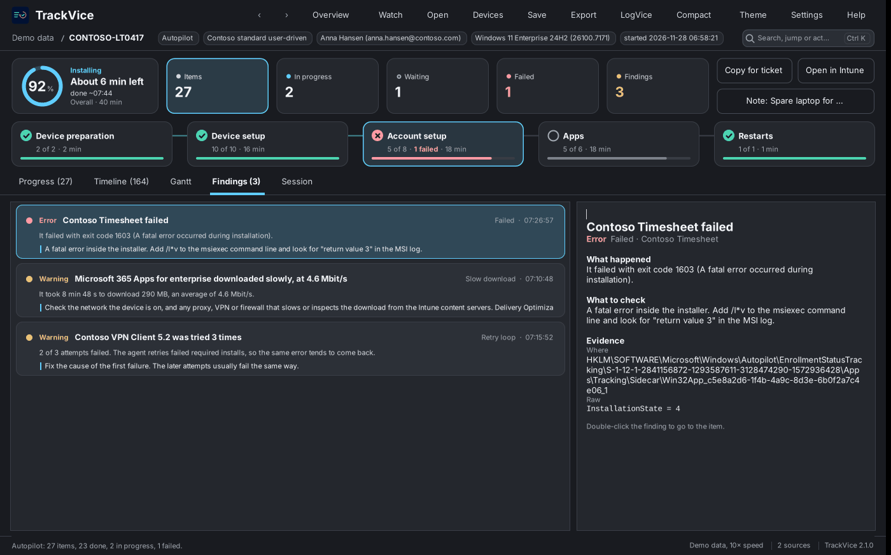

## Gantt

The **Gantt** tab shows every item as a bar from its start to its end, grouped by phase, on one time axis. A running item grows until now. A thin line marks each restart of the device. Click a bar to go to the item in the progress list.

| Button | What it does |
|---|---|
| **Policies** | Adds the Policies phase. It is left out at first, since policies arrive in an instant |
| **Only what took time** | Leaves out items that took less than a second, unless they still run |

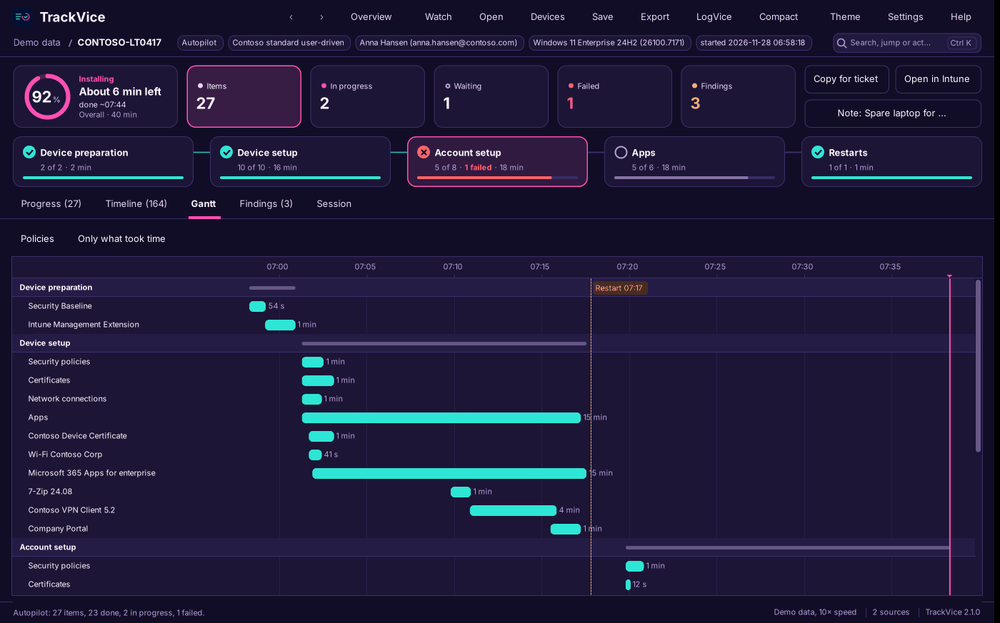

## Where to run it

| Where | How to start it | What it sees |
|---|---|---|
| Windows, as administrator | Start menu, or the portable exe | Everything |
| Autopilot OOBE and the ESP | Shift+F10, then run `TrackVice.exe` from a USB stick or a share | ESP, Autopilot, IME logs, event logs |
| Task sequence, full Windows part | F8 command prompt (command support must be enabled on the boot image) | smsts.log, and the ConfigMgr logs and WMI once the client is installed |
| Task sequence, Windows PE part | F8 command prompt | smsts.log only, and only if the boot image has the WinPE-NetFx component |

**Compact** opens a small window that stays on top: the phase, what is installing now with its progress, overall progress and the counts. It is made for OOBE screens and for watching over someone's shoulder.

<p align="center">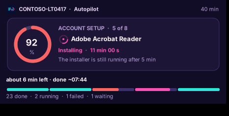</p>

## Percentage and time left

The overall percentage weighs every item by how long it is expected to take, so one slow app counts for more than a policy that applies in a second. The time left comes from the same expected times, so the two agree.

The expected times come from the finished deployments TrackVice has seen of the same customer and kind (the Autopilot profile or task sequence when known): the agent uploads Overview reads, sessions you open and the reference enrollment. Per customer and kind it keeps the newest 20 in `%LOCALAPPDATA%\TrackVice\history.json`: the total time from the start of the deployment to the end of its last item, the time per phase and per item, and the number and length of restarts. It uses the middle value (median) and the 20th to 80th percentile as the spread. Failed, still running and replaced deployments, ones where the device was off for more than an hour, and totals more than three times the middle are left out. Without history, the defaults per kind of item are used and the estimate is marked rough.

The time left counts what runs now (what is expected minus what has run, at least 30 seconds), what waits (apps one after the other, policies side by side and small) and the restarts still to come. Items that are not visible yet are covered by the historical total times what is left of it; the larger of the two is shown. With three or more earlier deployments the range is the spread; with fewer there is only the point. The finish time is now plus the point. The estimate never shows a time that has passed: when the deployment has run longer than the high end of the spread, it says "taking longer than usual (usually 35 min)".

The chip reads like `about 25 min left · 20–35 · done ~16:35`, with the basis (`Based on 6 earlier deployments of <profile>`) in its tooltip. In a narrow window the range is dropped first, then the clock. The Compact window and the Now rows of Overview show the same estimate, and the window title keeps the percentage only.

### Expected apps

A device only learns of the apps for the user when Intune delivers them after sign-in, so an Autopilot deployment that starts at "2 of 2" apps grows to "8 of 9", and the percentage and the time left jump with it. **Settings > Intune / cloud > Expected apps** lists the whole set from the start, as waiting items in the Apps phase. Each source has its own switch, both on by default:

| Source | What it uses |
|---|---|
| Expected apps from Intune | The apps Intune has assigned as required to the device and its user. It reads the device (by its Intune device ID, else its serial number, else its name) and its primary user, then `beta/users/{id}/mobileAppIntentAndStates/{device id}`, the app list the Intune admin center shows for a device. Required installs (`requiredInstall`, `requiredAndAvailableInstall`) are expected, required removals are listed apart with their own wording, and apps already installed or not applicable are left out. It needs an Intune sign-in for the customer and uses `DeviceManagementManagedDevices.Read.All` of that sign-in, and `DeviceManagementApps.Read.All` if Intune asks for it (tick App names under Names from Intune). It is read once, every 5 minutes while the deployment runs, and once more when the user phase starts. There is no fallback that works out the assignments from groups, because that needs permission to read groups and directory objects |
| Expected apps from earlier deployments | The apps seen in at least 60 % of the newest ten finished deployments of the same customer, kind and profile (see [Percentage and time left](#percentage-and-time-left)), when there are at least two. No sign-in needed. Used when Intune is off, not signed in or cannot be read |

Expected apps the device has not shown yet are items in the Apps phase, in their own group "Expected, not on the device yet", dimmed and labelled Expected, with where the expectation comes from: "Assigned in Intune, not on the device yet" or "Usually installed (in 4 of 5 earlier deployments)". They count in the phase totals ("2 of 9"), the overall percentage and the time left, weighed by how long that app took before. They are never failed and never raise an alert, are not part of the Enrollment Status Page logic, are not in the Timeline or the Gantt, and exist only in the viewer: a saved or uploaded session does not have them. When the real item shows up, matched by app ID and else by name, its placeholder goes. The Session tab says `Expected: 9 apps (Intune)` or `(from 5 earlier deployments)`.

A deployment is done when everything seen is done or failed and nothing new has come for 15 minutes; an Autopilot device that waits for its user to sign in is given an hour. Then the apps that never came are dropped. For the Intune source, an app that was required but never seen is a warning on the Findings tab, "Not installed: assigned but not seen on the device", unless something failed. Switch both sources off and the Apps phase shows only what the device has shown.

## Other devices

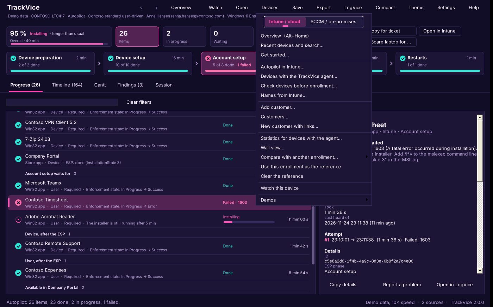

**Devices** (Ctrl+D) lists deployments on other devices and follows the one you pick, in the same window as a local deployment.

A switch at the top of the Devices menu chooses one of two sides, and the menu shows only that side. TrackVice remembers the last one, and a customer can have both.

| Side | Holds |
|---|---|
| Intune / cloud | Autopilot in Intune, devices with the TrackVice agent, Check devices before enrollment, Pre-flight check, Names from Intune, Add customer, Customers and New customer with links |
| SCCM / on-premises | Task sequences in SCCM, devices with the agent in a task sequence, the SMS Provider connection, and Add the agent to a task sequence |
| Both | Statistics, Wall view, Compare, the reference, Watch this device, and **Demos** |

A side with nothing set up says what it needs to start: a sign-in or Add customer for Intune, the SMS Provider for SCCM. Statistics and the list of devices with the agent have a filter for Intune, SCCM or both. A task sequence followed by Autopilot counts for both.

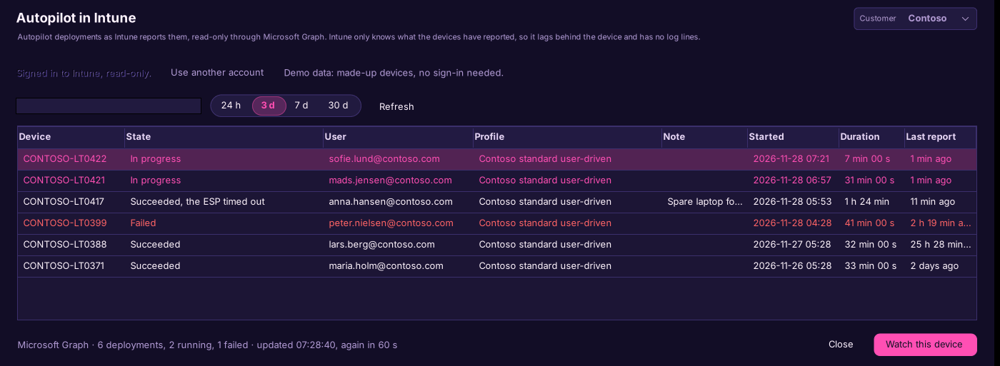

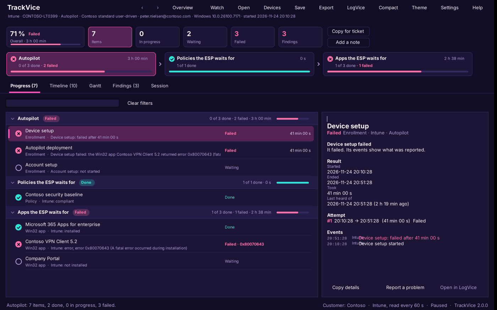

### Autopilot in Intune

TrackVice signs in to Microsoft Graph with a device code, read-only, and reads the Autopilot deployment events that the Intune Autopilot deployments report is built on.

| | |
|---|---|
| Permission | `DeviceManagementManagedDevices.Read.All`, delegated. Your tenant may need an administrator to consent to it |
| App | Microsoft Graph Command Line Tools, or your own app registration set in Settings |
| The list | Device, state, user, profile, when it started, how long it has run and when Intune last heard from it. Refreshed every minute |
| One device | Device setup and account setup with their state and duration, the failure Intune recorded, and every app and policy with its status and error code, split into what the ESP waits for and the rest. Read every minute |
| Sign-in | Kept encrypted for your Windows account, per customer, until you sign out in Settings |

Intune only knows what a device has reported, so this view lags behind the device and has no log lines. For every step as it happens, run TrackVice on the device itself.

### Task sequences in SCCM

**Devices > SCCM / on-premises > SMS Provider connection** saves the server, usually the site server, with the customer in use. TrackVice connects to it with your Windows account, the way the console does, and reads the status message each task sequence step sends to the site (`SMS_TaskSequenceExecutionStatus`).

| | |
|---|---|
| Rights | A role that can read task sequence deployment status, for example Read-only Analyst, and remote WMI access to the SMS Provider |
| The list | One row per run: device, state with the last step, task sequence, deployment, when the run started and the last status. A run begins at the start message of the task sequence (11140). Only the newest run of each device and deployment shows; **Show earlier runs** lists the others. Refreshed every 30 seconds |
| One run | Each step of that run under its task sequence group, with its exit code and the step's output as evidence. Read every 15 seconds |

Status messages arrive a little after each step, and a step only shows once it has reported. A device sends the messages it kept during Windows PE and restarts when it can, and they show in their run with the time of the step. A device in Windows PE with no network sends nothing until it can reach the management point.

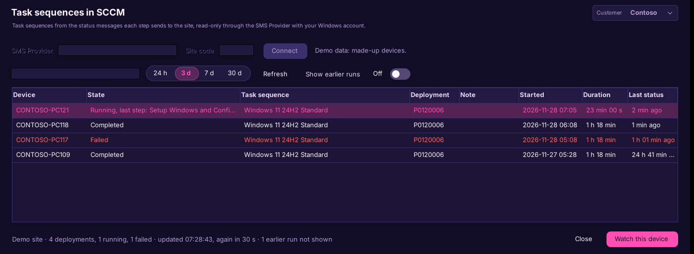

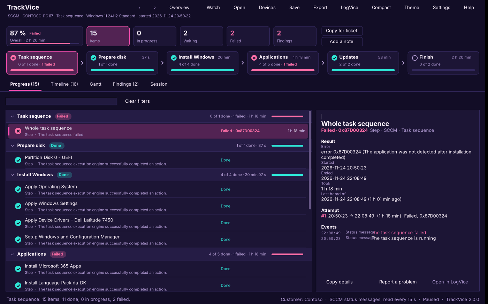

### Devices with the TrackVice agent

Intune and SCCM only know what a device has reported. With the agent, the device sends everything: TrackVice runs on it without a window while it deploys, and uploads its whole session as it changes to an Azure Storage container or a folder. The list shows every device that has uploaded, and watching one gives the same view as running TrackVice on it, with the log lines behind every event.

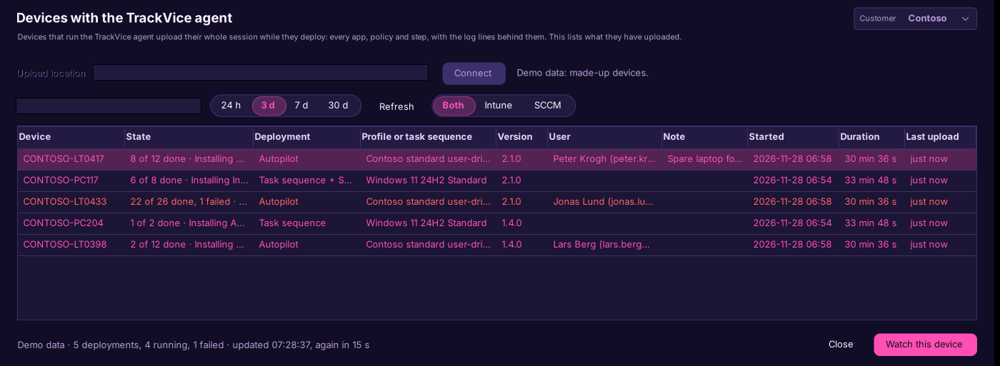

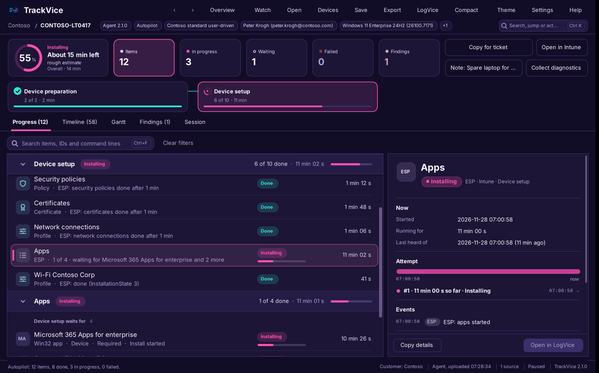

| | |
|---|---|
| Set up | **Settings > Your storage** once: one storage account in your Azure, where TrackVice versions are published. Then **Devices > Add customer** in three steps: a private container per customer, a customer code, and in Intune a dynamic group of Autopilot devices with the platform script assigned to it |
| Install | The platform script `agent/Install-TrackViceAgent.ps1` holds one line, the customer code. On the device it downloads the newest signed TrackVice from your storage, checks it and runs `TrackVice.exe /agent-install /customer "<code>"`. A Win32 app can run the same command |
| On the device | A startup task that runs as SYSTEM, survives restarts and a pre-provisioning reseal, and removes itself 48 hours after the deployment is done, and at most 30 days after it was installed |
| Location | A container SAS link: Create and Write for the devices, Read and List for the viewer. Or a folder. Setups made with links per customer keep working with `agent/Install-TrackViceAgent-Links.ps1` |
| The list | Device, progress with the current item, deployment, profile, start, duration and last upload. Refreshed every 15 seconds |
| One device | Everything the device itself shows. Read every 5 seconds |

The agent can also run in an **SCCM task sequence**, from Windows PE to the end, as one session. It can send **alerts** to a Teams channel when something fails, and it uploads the **device's logs** beside the session. An installed agent **updates itself** to the version you publish once to your storage, signed with a key only your PC has.

**[AGENT.md](AGENT.md) is the guide**: Your storage, Add customer, the customer code, testing on one device, new versions, alerts, task sequences, the setup with links for existing customers, maintenance and troubleshooting.

All three have a demo with made-up devices under **Devices > Demos**, so you can see them without signing in.

### Wall view

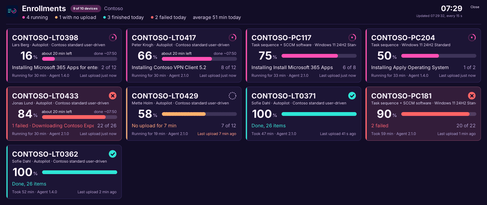

**Devices > Wall view** shows every device with the agent on one screen, made for a screen in the room where devices are set up. It opens full screen; F11 switches, Esc leaves. Each device is a tile with its progress, what runs now or how it ended, how long it has run and its last upload. A device that has not uploaded for 5 minutes says so. The top line counts what runs, and what finished and failed today, with the average time.

Move the mouse to show the filters: All, Running, Failed or Finished today, a search for devices and profiles, and how long finished devices stay (1 to 8 hours). Failed devices stay until midnight. It reads the uploads every 15 seconds, and F5 reads them at once. Click a tile to watch the device. `TrackVice.exe --wall` starts in it.

### Check devices before enrollment

**Devices > Check devices before enrollment** finds problems before a device is turned on. Type or paste serial numbers, one per line or a CSV such as a hardware hash export, or pick them with **From Autopilot**. For each device it reads from Intune:

| Check | What it says |
|---|---|
| Windows Autopilot | Registered or not, or more than once, the group tag, the assigned user, the profile assignment state and the Entra device object |
| Deployment profile | The profile, join type and mode, and the device name its template gives, with a warning over 15 characters |
| Enrollment Status Page | Which ESP applies and why, its time limit and the apps it blocks on |
| Prediction | How long those apps took in the agents' uploads of the last 30 days, a warning near the time limit, and apps that failed often |

It needs `DeviceManagementServiceConfig.Read.All`. Two switches add more: the names of the blocking apps with `DeviceManagementApps.Read.All` (on at first), and the device's groups with `Device.Read.All`, to tell which group-targeted ESP applies. The prediction uses the uploads of the agent list you connected to. **Export CSV** and **Export HTML** save the result.

### Pre-flight check

**Devices > Intune / cloud > Pre-flight check** asks Intune whether a device will deploy, before it is turned on, and answers with a checklist. Paste one or more serial numbers (one per line, or a CSV such as a hardware hash export), pick the customer at the top right, and press **Check** (Ctrl+Enter). It uses the Intune sign-in of that customer and asks for the permissions it lacks. It only reads.

Each device gets a verdict, **Ready**, **Check** or **Will fail**, and its lines: ✓ fine, ! look at this, ✕ this stops the deployment. A line that is not fine comes with the fix. A device that is ready starts closed; click its row to open it.

| Part | What it checks |
|---|---|
| Windows Autopilot | Registered or not, or more than once; the group tag, model, assigned user, enrollment state and last contact; whether a deployment profile is assigned, pending, out of sync or failed, and its name |
| Groups | The groups of the Entra device, and of the assigned user when they can be read |
| Enrollment Status Page | Which ESP the device gets (its groups, else all users, else the default), the time limit, and what it blocks on: the selected apps or every required app. Apps in the blocking list that are gone from Intune. A Win32 app that installs for the user but is assigned to the device and blocks. How long the blocking apps usually take against the time limit |
| Required apps | The Windows apps required for the device's groups and the user's groups, with All devices, All users and exclusions. An app that is both required and set to uninstall. A dependency that is not installed automatically and is not required for the device. Supersedence that goes in a circle. Line-of-business MSI apps next to Win32 apps |

The times are the medians of the finished Autopilot deployments TrackVice has seen for the customer on this PC ([Percentage and time left](#percentage-and-time-left)); without them no time is estimated. **Copy as text** puts the whole checklist on the clipboard, for a ticket or a mail.

| Permission | Read with it |
|---|---|
| `DeviceManagementServiceConfig.Read.All` | Autopilot devices, deployment profiles and Enrollment Status Pages. Always needed |
| `DeviceManagementApps.Read.All` | Apps with their assignments, dependencies and supersedence. Switch **Apps** |
| `DeviceManagementConfiguration.Read.All` | The names of assignment filters. Asked for with **Apps** |
| `Device.Read.All` | The groups of the device. Switch **Groups** |
| `GroupMember.Read.All` | Group names, and the groups of the assigned user. Asked for with **Groups** |

A read that is refused says which permission is missing, as a line of its own, and the other checks go on. With a switch off, the sign-in does not ask for its permissions and the lines say what was left out.

### Customers

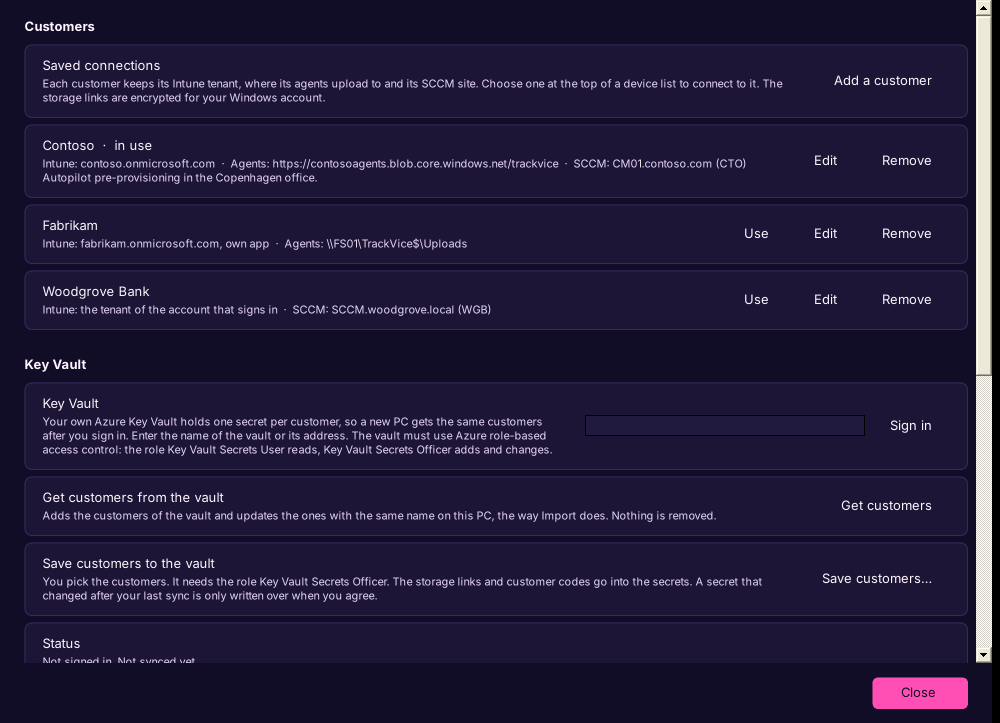

If you work for several customers, TrackVice keeps the connection details of each: the Intune tenant and client ID, the agent upload location and the SCCM site. Choose a customer at the top of any device list to connect to it. **Settings > Customers** adds, edits and removes them, and imports and exports them to move them to another PC. The storage links are encrypted for your Windows account. An export only has them when you tick **Include the storage links**, and then the file is always protected with a password (a `.tvcustomers` file). Import reads both that file and the older JSON.

**Customers in your own Key Vault.** Settings > Customers > Key Vault keeps your customers in an Azure Key Vault in your own subscription, one secret per customer. On a new PC, enter the vault address, press **Sign in** (Entra ID, with a code) and **Get customers from the vault**. **Save customers to the vault** puts the ones you pick there. It only adds and updates, never deletes, and asks before it overwrites a secret that changed after your last sync. The vault must use Azure RBAC: **Key Vault Secrets User** reads, **Key Vault Secrets Officer** adds and changes. Key Vault encrypts the secrets, logs who read them, and Conditional Access and MFA apply to the sign-in. Each PC still keeps its own copy, so it works offline.

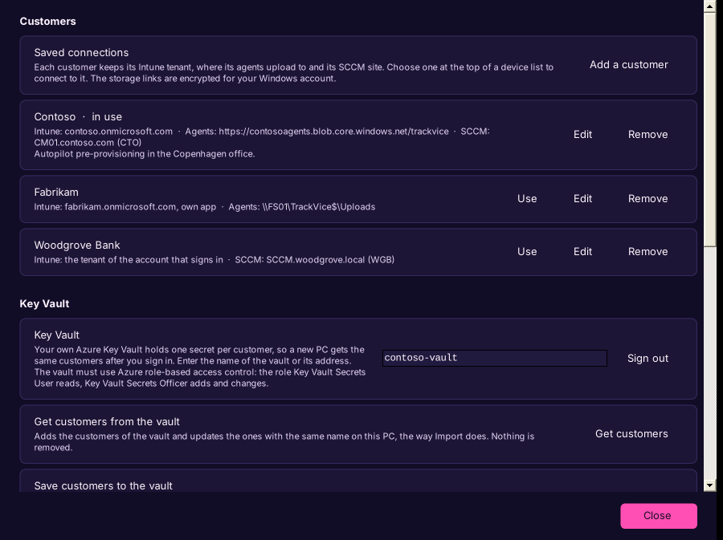

**The whole setup in the vault.** **Save my setup to the vault** also saves Your storage (the account, the links and the account key) and the update key, in two secrets that start with `trackvice-`. On another PC, **Get my setup from the vault** (also in Publish, when it finds another update key, and in Get started) fetches them, and that PC can then publish and add customers like the first one. A key on the PC is never replaced without asking, and nothing in the vault is ever deleted. The update key is the one secret that lets someone sign updates for every device, so give the role on that secret only to the people who may publish. Azure RBAC can be set per secret. If an account can read the customers but not the update key, TrackVice says so and gets the rest.

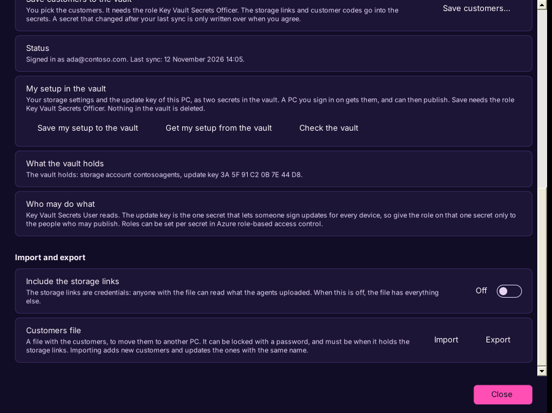

**Download scripts and app details.** In a deployment you follow for a customer, right-click an Intune script or remediation, an app, an SCCM task sequence step or an SCCM application and choose **Download…** to save its script text, command lines, or for an app its details: install and uninstall command, detection rule, requirements, return codes and assignments. The installer files of apps are not downloaded. It is off until you turn on **Allow downloading scripts and app details** for the customer in Settings > Customers. **Ask before each download** and **Hide secrets in downloads** are on at first. Every download is written to `downloads.log` in the TrackVice folder with the time, Windows user, customer, item and file name, never the content, and **Open the log** shows it. A customers file you import never turns downloads on. Task sequence steps can be downloaded from remote SCCM runs. A device list that connects with details you type in saves them as the customer Default.

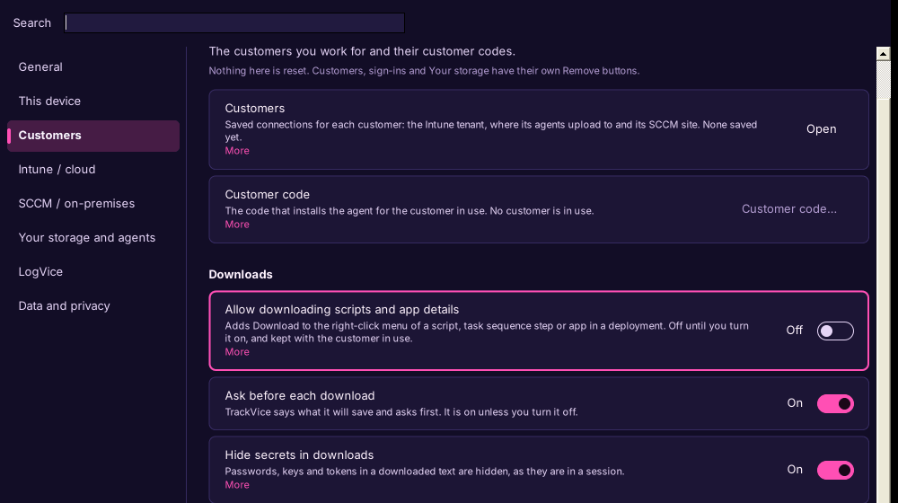

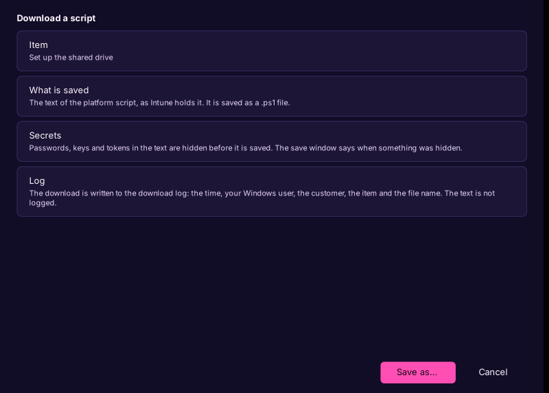

**Devices > Add customer** adds the agent for a new customer in three steps: the customer, a sign-in to its tenant, and Create. It makes a container in your storage, the customer code and the platform script, and can add the script to Intune. Nothing is made until you press Create. For a name that exists, it asks first: updating the customer makes new links, and the old ones stop.

Step 3 has three choices for the script's assignment: create the group **TrackVice - Autopilot devices** (every Autopilot device), **a group I choose** from a search of the tenant's security groups, or **do not assign**. In a production tenant, start with a small test group, then change the assignment to all Autopilot devices. **Customer code…** on a customer's row shows the code, changes the alert link and updates the script in Intune. See [Add a customer in three steps](AGENT.md#add-a-customer-in-three-steps). **Devices > New customer with links** is the earlier guide, with a storage account and links per customer, and `agent/New-TrackViceCustomer.ps1` does its Azure part.

### Statistics

**Devices > Statistics for devices with the agent** reads every session the agents uploaded in the last 24 hours, 7, 30 or 90 days.

| Part | Contents |
|---|---|
| Chips | Enrollments, finished, with failures, and the average, median and longest time of the finished ones |
| Apps, scripts and steps | Each item over every enrollment: kind, devices, failed, fail rate, average and longest time, the average download time and speed of Win32 apps, and the device where it was slowest |
| Enrollments | Each enrollment: device, deployment, profile, start, duration, items, failed and its slowest part, and whether it matches the reference. Double-click one to watch it |

**Export CSV** saves the table you see. **Export for Power BI** saves every enrollment of the period in a folder as `Enrollments.csv`, `Items.csv` and `Findings.csv`, linked by SessionId, with a `README.txt` that describes the columns and how to load them. Times only count finished enrollments, and the fail rate only counts devices where the item finished.

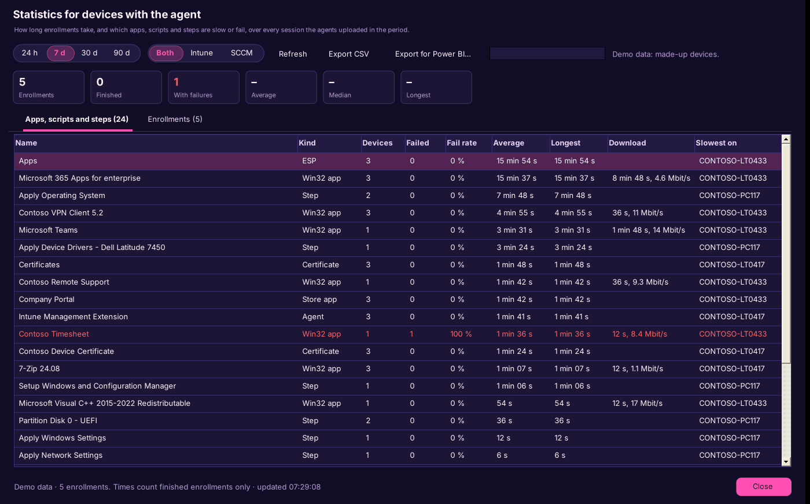

### Compare

**Devices > Compare with another enrollment** puts the session you watch (A) beside another one (B): **A device with the agent** from the uploads, or **A saved session file**. The table shows items only one side has, different results, exit codes and tries, times that differ by at least a minute and half again as long, and findings only one side has. Items match by ID first, then by name. Select a row to see its last events on both sides. **Only differences** hides the items that are the same, and **Export** saves the table as CSV.

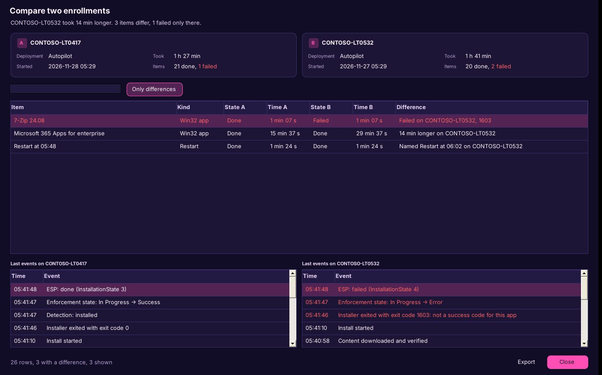

### Reference enrollment

**Devices > Use this enrollment as the reference** keeps the enrollment you watch as the reference of the customer in use: its items, results and times, in `%LOCALAPPDATA%\TrackVice\References`. Every enrollment you watch for that customer is then compared with it. A badge in the header says whether it matches, and a **Differs from the reference** finding lists what is missing, extra, failed only here or clearly slower. While items still run, items it has not reached yet are not counted as missing. **Compare with another enrollment > The reference** shows every item side by side. **Clear the reference** removes it.

**Export > Ready to ship report** writes one page that says whether the device can go to its user: not ready when an item failed, still runs or has not started, or an item of the reference is missing. Extra and slower items are listed but do not stop it. After pre-provisioning, account setup waiting for the user does not count. It lists what was installed, the reference check, and lines for the technician's name, signature and date.

### Names from Intune

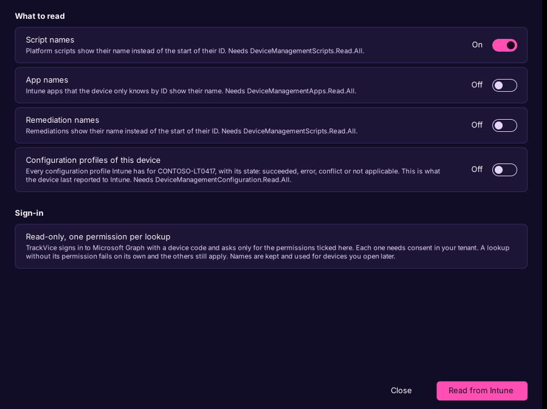

A device knows platform scripts, remediations and some apps by ID only. **Devices > Names from Intune** reads from Intune what you tick, each with a read permission of its own:

| Lookup | Permission | What you get |
|---|---|---|
| Script names | `DeviceManagementScripts.Read.All` | Platform scripts show their name |
| App names | `DeviceManagementApps.Read.All` | Intune apps the device only knows by ID show their name |
| Remediation names | `DeviceManagementScripts.Read.All` | Remediations show their name |
| Configuration profiles of this device | `DeviceManagementConfiguration.Read.All` | Every configuration profile Intune has for the device, with its state: succeeded, error, conflict or not applicable, as the device last reported it to Intune |

The sign-in asks only for the permissions of what you ticked, and each needs consent in your tenant. A lookup without its permission fails on its own and the others still apply.

The names and the sign-in are kept on your PC for each customer: the names in `%LOCALAPPDATA%\TrackVice\Names`, the sign-in encrypted for your Windows account. At the next start the names are there at once, also in Statistics and Compare, and are read again in the background once a day. When a device shows a script, app or remediation by its ID, TrackVice asks Intune for the new names by itself. You sign in again only when Microsoft asks for it. **Settings > Intune sign-in > Sign out** deletes the kept sign-in and names of the customer in use.

### Logs from the device

When you watch a device with the agent, **LogVice > Logs from the device** downloads the zip of logs the device uploaded, unpacks it under `%LOCALAPPDATA%\TrackVice\Logs` and opens the folder. **Open in LogVice** on an item or an event opens the device's copy of that log. Copies older than 30 days are removed.

## Watch, save and share

**Watch** reads the device every 2 seconds: new log lines, ESP tracking changes and new event log records every time, and the Win32 app registry state and ConfigMgr client WMI every third time. It reads logs from the last 24 hours when it starts. On a device that was deployed some time ago, set **History to read** to **Since install**.

ESP and Win32 app states come from the registry, and always carry the time their key was written, so a deployment that finished weeks ago shows when it really happened.

## Settings

**Settings** (Ctrl+,) holds the customers, the theme, how far back to read (6 hours to 30 days, or everything since Windows was installed), whether to read ConfigMgr client WMI and the event logs, whether to start watching when TrackVice opens, how often to read while watching, how long to wait before an item gets a **No progress** finding, and where LogVice is. They are kept in `HKCU\Software\TrackVice`. **Your storage** sets up the storage for all customers and publishes new versions to it, see [AGENT.md](AGENT.md#set-up-once-your-storage). **Agent updates > Publish agent update** publishes a new agent version for setups with links, see [AGENT.md](AGENT.md#agent-updates). **Updates** is described below.

### Updates

At every start (about 8 seconds after the window is shown) and every 6 hours while TrackVice is open, TrackVice asks GitHub (`api.github.com`) for its latest release. Following or watching a deployment does not stop the check. When it is newer, the status bar says so with **Install**. Install downloads `TrackVice.msi`, or `TrackVice.exe` for a copy run from a folder, to a new folder under `%LOCALAPPDATA%\TrackVice`, checks it against the release's `SHA256SUMS.txt`, installs it and opens TrackVice again. Install is refused only in Windows PE, as SYSTEM, while a task sequence or Windows setup / the Enrollment Status Page runs on this device, or by the policy. When Watch is on, TrackVice restarts to update, then opens again and continues watching this device. It then offers to publish the new version to Your storage. Pre-releases are not offered.

**Settings > Updates** turns the check on or off, has **Check now**, and says when it last checked. **Release page** opens the TrackVice releases on GitHub, and **What's new** shows the changelog that comes with TrackVice, newest first, with this version marked. To turn it off for everyone, set the DWORD `DisableUpdateCheck` to 1 under `HKLM\SOFTWARE\Policies\TrackVice`.

There is no check on the command line, as the agent, in Windows PE, during Windows setup or the ESP, while a task sequence runs or TrackVice follows a deployment on the device, or as SYSTEM.

**Save > Save the session** writes everything as one JSON file that opens on any PC. **Save > Collect the session and its logs in a zip** adds every log file the session has a line from, so a supporter can send the evidence instead of the device. **Open > Open a folder of logs** reads a CCM Logs folder, an IME Logs folder or an unpacked bundle; it reads every log TrackVice knows in it and its subfolders, including rolled-over copies.

**Export** writes an HTML report, every event as CSV, or a [ready to ship report](#reference-enrollment). The report has a summary with the result and the slowest items, the findings, the deployment details, a time line like the Gantt tab, details per phase and every event. It follows the light or dark mode of the browser and has a print layout.

### Customer report

**Export > Customer report (PDF)** makes a report of the device you watch that is meant to be handed to the customer. It asks for the customer's name and for who prepared it (your Windows display name at first, remembered once you change it), then where to save it. The report is one HTML file with nothing to load from elsewhere, always light and laid out for A4. When Microsoft Edge is installed, TrackVice also has Edge print it to a PDF with the same name next to the HTML file and opens the PDF. Edge gets 60 seconds; if it is missing, does not finish or makes no PDF, the HTML file stays and the status line says why.

It shows the customer and the device with the result as a badge (**Done**, **Done with failures** when the device is set up but an item failed, or **Failed** when the task sequence or a step the Enrollment Status Page waits for failed), the serial number, model, user, Autopilot profile or task sequence, start, end and total time without the time the device was off. Then a bar per phase over time with the restarts marked, the apps, scripts, policies and steps with state, attempts and duration (failed first, then the slow ones, then the rest; policies are counted and only the failed ones listed), the findings with their explanations, and the restarts and network outages. Passwords, keys and tokens are hidden the same way as in **Copy for ticket**.

**Overview > Report** makes the same kind of report over the devices of the current filter (customer, Intune or SCCM, search) that started in a period: today, the last 7 or 30 days, or days you pick. It has the number of devices, done and failed, the success rate (done with no failed item, of those that ended), the median time and the time 90 % finished within, a bar per day, the table of devices, the items that failed on most devices and the slowest ones. **A page for every device** adds the device report of each device after it, each starting on a new page; in the HTML and the PDF the device names in the table lead to them.

`/fleet-report` writes one report over every enrollment the agents uploaded to a location: the duration over time, every enrollment, the slowest items and what fails most. `/export-data` writes the same enrollments as CSV tables for Power BI.

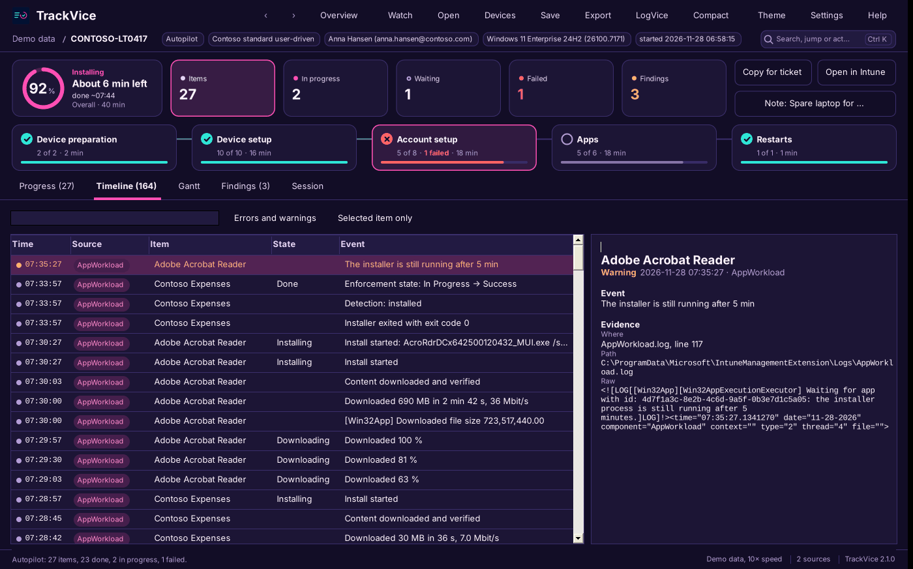

## Command line

```text
TrackVice.exe                          Watch this device
TrackVice.exe <session.json>           Open a saved session
TrackVice.exe <folder>                 Read a folder of logs, such as a CCM Logs folder or a collected bundle
TrackVice.exe --demo [osd]             Play the Autopilot demo, or with osd the task sequence demo
TrackVice.exe --wall [/upload <location>]
                                       Start in the wall view. Without /upload it uses the location of the customer in use

TrackVice.exe /report <file.html>      Save an HTML report of this device and exit
TrackVice.exe /csv <file.csv>          Save every event as CSV and exit
TrackVice.exe /session <file.json>     Save the session as JSON and exit
  /folder <path>                       Read a folder of logs instead of this device
  /hours <n>                           Hours of history to read (default 24, 0 for everything since Windows was installed)
  /title <text>                        The title at the top of the report

TrackVice.exe /ship-report <file.html> [/from <session.json>]
                                       Save a ready to ship report of this device, or of a saved session, checked
                                       against the reference of the customer in use, and exit
  /folder <path>                       Read a folder of logs instead of this device

TrackVice.exe /fleet-report <file.html> /upload <location>
                                       Save an HTML report over every enrollment the agents uploaded there and exit
  /hours <n>                           The uploads of the last n hours (default 24, 0 for all)
  /title <text>                        The title at the top of the report
TrackVice.exe /export-data <folder> /upload <location>
                                       Save every enrollment the agents uploaded there as CSV tables for Power BI
  /hours <n>                           The uploads of the last n hours (default 24, 0 for all)
  /side intune|sccm|both               With /fleet-report or /export-data: only the enrollments of Intune, of SCCM
                                       task sequences, or both (default)

TrackVice.exe /agent-install /customer <code>
                                       Install the agent with the customer code from Add customer: the upload link,
                                       the alert link, the settings, and self-update from your storage
TrackVice.exe /agent-install /upload <location>
                                       Install the agent. The location is a storage container SAS link or a folder
  /keep <hours>                        Hours the agent stays after the deployment is done (default 48)
  /max-days <days>                     Days after install when the agent always removes itself (default 30)
  /update-key <key> /update <location> Install newer versions published there, signed with this key. The location
                                       is a SAS link with Read, or a folder
TrackVice.exe /agent-remove            Remove the agent
TrackVice.exe /agent-start /upload <location>
                                       In a task sequence: start the agent in the background and return at once.
                                       /customer <code> works here too, instead of /upload
  /id <id>                             The session ID, kept across restarts (default: from the device's hardware)
  /keep <hours>                        How long it runs at most (default 48)
TrackVice.exe /agent-stop              Make the last upload and stop the agent started with /agent-start
TrackVice.exe /agent /upload <location>
                                       Run the agent here without installing it
  /once                                Upload one time and exit
  /alert <link>                        With /agent, /agent-install or /agent-start: send failures and the end
                                       of a deployment to a Teams workflow or other webhook
  /no-mask                             With /agent, /agent-install or /agent-start: upload passwords, keys and
                                       tokens as they are, without hiding them
TrackVice.exe /agent /alert <link> /alert-test
                                       Send one test alert and exit
TrackVice.exe /publish-agent /to <location> [/exe <path>]
                                       Upload this TrackVice.exe, or the given one, with a signed agent/latest.json
                                       for the agents to update to. The location needs Create and Write

TrackVice.exe /?                       Show this list (also /h and /help)
```

Options start with `/` or `-`. `/ts` is added by `/agent-start` to the agent it starts; you do not give it yourself. [AGENT.md](AGENT.md) explains the agent options.

The exit code is 0 when done, 1 on an error and 2 when failed items were found (for `/fleet-report`: when an enrollment had failed items; for `/ship-report`: when the device is not ready), so it works in a script or an Intune remediation. In PowerShell, use `Start-Process -Wait -PassThru` to get the exit code.

## Keyboard

| Key | Action |
|---|---|
| F5 | Read everything again |
| Ctrl+W | Start or pause watching |
| Ctrl+F | Search items, IDs and command lines |
| Ctrl+O | Open a saved session |
| Ctrl+S | Save the session |
| Ctrl+E | Export an HTML report |
| Ctrl+L | Open the selected item's log in LogVice |
| Ctrl+M | Compact view |
| Ctrl+D | Other devices |
| Arrow keys | Move through the list; Left and Right fold and unfold a phase |
| Ctrl+C | Copy the selected row |
| Ctrl+, | Settings |
| F1 | About and the command line |
| Esc | Clear the search, or close a page |

## Privacy and safety

TrackVice only reads. It never starts, retries or cancels a deployment, and writes nothing to the device except its own settings in `HKCU\Software\TrackVice` and the files you save. At every start and every 6 hours while it is open it asks `api.github.com` for the latest TrackVice release, unless that is turned off in Settings > Updates or by the policy value `DisableUpdateCheck`; it sends nothing about you or your devices, and downloads an update only when you press Install. Otherwise it makes no network connections unless you open something under **Devices**, **Your storage** or **Publish agent update**: then it talks to Microsoft Graph, to the SMS Provider you name, to the upload location you enter, and in **Your storage**, **Add customer** and **New customer with links** to Azure, and nothing else. The upload locations of your customers and the Intune sign-in are encrypted for your Windows account. Once Your storage is set up, TrackVice also reads `agent/latest.json` from it at start, to offer a newer version for publishing.

These change something outside your PC, and only when you press their button: **Your storage** creates the storage account and container in your Azure. **Add customer** and **New customer with links** create the customer's storage, and, if you choose, the group and the platform script in Intune. **Customer code…** replaces the content of the platform script after you confirm. **Publish** and **Publish agent update** write a new version to your storage or the location you give. The account key of your storage and the customer codes are kept encrypted for your Windows account. Check devices before enrollment and Pre-flight check only read. The signing key for agent updates is kept in `%LOCALAPPDATA%\TrackVice\agent-update-key.bin`, encrypted for your Windows account.

The agent is the one exception, and only where you install it: it adds a scheduled task, a folder in Program Files and a registry key, uploads the device's session to the location you gave it, and removes its task and key when its time is up. With an update key it replaces its own TrackVice.exe in its folder with a version signed with that key, and keeps the one before as `TrackVice.exe.old`. In a task sequence it installs nothing; it keeps its log and a small state file under `%WINDIR%\Temp\TrackVice`.

What the agent sends:

| | |
|---|---|
| Masking | Before a session or an alert leaves the device, passwords, keys and tokens in command lines, script output and log lines are replaced by `***`. It finds them by name (such as password, secret, token, key and `sig`), by switches such as `-Password`, and in `Bearer` headers, `user:password@` in links, `ConvertTo-SecureString` and `net user`. It is on by default; `/no-mask` turns it off. It cannot catch every secret, so treat the uploads like the logs themselves |
| Alerts | With `/alert`, the device name, the deployment, the progress, the title, text and advice of each failure, and how long the deployment took when it finished go to the webhook address you gave, and from there into Teams. Nothing else is sent there |
| Log zips | The zip of logs holds the session and the log files as they are on the device: every log the session read, the Intune Management Extension logs and the task sequence logs. Masking covers the session in it, not the log files. A log over 20 MB goes in as its last 20 MB, and a zip over 60 MB is not uploaded |

## Limitations

- The Intune view uses a beta Graph API, which Microsoft can change, and the status message names the SCCM view reads differ a little between ConfigMgr versions.
- Microsoft does not document the log formats of the Intune Management Extension and HealthScripts.log, the ESP registry layout, or the fields of the Autopilot events. TrackVice follows them as they are today, and they can change.
- Autopilot device preparation keeps the progress of its own page in no documented place, so that progress is not shown.
- Configuration profiles from Names from Intune are what the device last reported to Intune, not what it has right now.
- Expected apps from Intune reads a beta Graph API and shows what Intune says at that time; the permission it needs is not documented in one place and could not be checked against every tenant. Expected apps from earlier deployments know apps by name only, so a renamed app counts as a new one.
- LogVice 1.5 and older cannot open a log at a line, so TrackVice says in the status bar which line to look for. LogVice 2.0 or later opens at the line.
- The Intune Management Extension log format changes between IME versions. Lines TrackVice does not recognise are left out, and the ESP and Win32Apps registry keys still give the state.
- The Windows PE part of a task sequence needs WinPE-NetFx in the boot image for TrackVice to start there.
- User-targeted SCCM applications are only fully visible from the user's own session.
- The exe and MSI are unsigned. SmartScreen warns on downloaded copies, and AppLocker or WDAC need them signed with your own certificate.
- Restarts come from the System event log of the device. A folder of logs, Intune and SCCM have none, and the agent in Windows PE reads no event logs.
- Download size and time are what `AppWorkload.log` says. Delivery Optimization keeps its own data in no documented place, so bytes from peers show only when a log line names them.
- The wall view reads only what each upload says about itself. An agent older than 1.1.0 does not say when it finished, so the wall counts from when it first saw it finished.
- Pre-flight check reads beta Graph APIs for Autopilot, the ESPs and the apps, and shows what Intune has at that time. Assignment filters are named but not evaluated, because a filter looks at the enrolled device. An ESP or an app for users is only known for a device with an assigned user; in self-deploying mode nothing that targets users counts. Apps of other platforms are left out. Times match apps by name.
- Check devices before enrollment reads beta Graph APIs, and shows what Intune has at that time. Without `Device.Read.All` it cannot tell which group-targeted ESP applies, and an ESP for users is only known for a device with an assigned user. The prediction matches apps by name, over at most 300 enrollments.
- References are kept per Windows user on one PC. `/ship-report` on another PC, such as the device itself, has no reference and judges only the device.
- Only an installed agent updates itself, not one in a task sequence or started with `/agent`. The signing key cannot be moved to another PC or Windows user; a new key means new customer codes, or a new `$UpdateKey` in a script with links.
- Add customer has no fields for the 24, 48 and 30 in the customer code.
- A release without `SHA256SUMS.txt` is offered only as a download, not installed. Pre-releases are not offered.
- Show earlier runs lists the runs of the period read. Status messages the site no longer keeps are not shown.

## Build from source

TrackVice is plain C# 5 and Windows Forms on .NET Framework 4.5, with no NuGet packages, like LogVice and PolicyVice.

**On Windows**, with the compiler that ships with .NET Framework:

```powershell
.\build.ps1          # TrackVice.exe
.\build.ps1 -Msi     # also TrackVice.msi, needs WiX Toolset 3
```

**On Linux or macOS**, with Mono and msitools:

```sh
./build.sh           # TrackVice.exe
./package.sh         # TrackVice.exe and TrackVice.msi
./tests/run.sh       # the tests
```

| Path | Contents |
|---|---|
| `src/Model.cs` | Session, phases, items, attempts, events, evidence, findings; JSON save and load |
| `src/Track.cs` | Observations, the tracker that builds the session, findings and error decoding |
| `src/CmLog.cs` | CMTrace and simple ConfigMgr log parsing, and the tailer that follows a growing log |
| `src/Sccm.cs` | smsts.log, AppEnforce, AppDiscovery, AppIntentEval, execmgr, CAS and update logs |
| `src/Intune.cs` | IME logs, ESP tracking, Win32 app state and the Autopilot profile |
| `src/Ime.cs` | The Win32 app registry reader and error codes, shared with PolicyVice |
| `src/Live.cs` | Reads this device: log discovery, registry, ConfigMgr client WMI, event logs; and folders of logs |
| `src/Engine.cs` | Ties a source (device, folder, file, demo) to the session |
| `src/Remote.cs` | Other devices through Intune: Graph sign-in, Autopilot events and policy status |
| `src/RemoteSccm.cs` | Other devices through SCCM: the SMS Provider and task sequence status messages |
| `src/AutopilotEvents.cs`, `src/AutopilotFlow.cs` | Autopilot events, account setup, pre-provisioning, hybrid join and device preparation |
| `src/Remediations.cs` | Remediations from the IME registry and HealthScripts.log |
| `src/Why.cs`, `src/ErrorBase.cs` | Why things failed: error meanings, next steps, and findings over the whole session |
| `src/Agent.cs`, `src/AgentAlerts.cs`, `src/AgentTs.cs` | The agent, its stores, alerts, log uploads, and the agent in task sequences |
| `src/Insights.cs`, `src/Compare.cs` | Masking, statistics, alerts, log bundles, and the comparison of two enrollments |
| `src/Customers.cs`, `src/IntuneLookup.cs`, `src/DeviceLogs.cs` | Customers, names from Intune, and the logs a device uploaded |
| `src/ExpectedApps.cs`, `src/ExpectedIntune.cs`, `src/Ui.Expected.cs` | Expected apps: the merge into a session, the Graph read of the apps assigned to a device, and the settings and refresh in the window |
| `src/Report.cs`, `src/ReportFleet.cs` | HTML report, fleet report, CSV and the zip bundle |
| `src/Preflight.cs`, `src/PreflightGraph.cs`, `src/Ui.Preflight.cs` | The pre-flight check: the evaluation, the Graph reads and the page |
| `src/WallModel.cs`, `src/AgentUpdate.cs`, `src/Readiness.cs`, `src/Restarts.cs`, `src/Downloads.cs`, `src/Reference.cs`, `src/DataExport.cs`, `src/CustomerSetup*.cs` | Wall view, agent updates, check before enrollment, restarts, downloads, the reference and ready to ship report, the Power BI export and New customer with links |
| `src/CustomerCode.cs`, `src/CustomerInstall.cs`, `src/CustomerScript.cs`, `src/AddCustomer.cs`, `src/AddCustomerGroups.cs` | The customer code, `/customer`, the platform script for a code, Your storage, Add customer and its group search |
| `src/Welcome.cs`, `src/DeviceSides.cs`, `src/AppUpdate.cs` | The welcome and Getting started, the two sides of Devices, and updates from GitHub |
| `src/Demo.cs` | The two demos, written as real log lines and registry values |
| `src/Ui.*.cs` | The window, the phase rail, the progress list, the Gantt tab, the device lists, statistics, compare, customers, the compact view and the themes |
| `tests/` | Log parsing and tailing, every parser, the tracker, findings, save and load, and both demos end to end |
| `agent/` | The platform script that installs the agent with a customer code, the one with links for existing setups, and `New-TrackViceCustomer.ps1` |
| `art/` | The icon, drawn in the same style as the other Vice icons |
| `release.ps1`, `bump.ps1`, `bump.sh`, `sums.sh`, `winget/` | Release tooling, see [RELEASE.md](RELEASE.md) |

